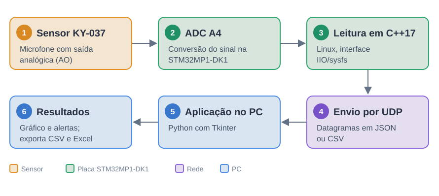

# Sistema de Monitoramento Acústico com STM32MP1 e Telemetria UDP

<p align="center">     </p>

O KY-037 é lido pela STM32MP1-DK1 em Linux. Uma aplicação C++ envia as contagens do ADC por UDP para uma interface Python/Tkinter no computador, que exibe o histórico, sinaliza leituras fora dos limites configurados e exporta os dados. O sistema foi demonstrado com o sensor e a placa reais.

<p align="center"><a href="evidencias/entrega5/interface.gif"></a></p>

[Vídeo da demonstração](https://drive.google.com/file/d/1BVW8qoyFHY4mEYED9KS1cEBujymM_ru7/view?usp=sharing) · [Guia técnico completo](docs/guia-tecnico.md) · [Histórico e evidências das entregas](docs/historico-entregas.md)

## Arquitetura

<p align="center"></p>

| Componente | Responsabilidade |
|---|---|
| `SensorSom` e `MonitoramentoSom` | Ler o arquivo IIO e organizar amostras periódicas. |
| `ProtocoloSom` e `ClienteUDP` | Serializar a leitura e transmitir cada datagrama. |
| `telemetria_gui.py` e `interface_grafica.py` | Validar pacotes, manter o histórico e atualizar a interface. |
| `relatorio_excel.py` | Gerar a planilha com leituras, eventos e gráfico editável. |

A saída `AO` do sensor vai à entrada **A4**; `+` recebe **3,3 V**, `G` vai ao **GND** e `DO` permanece desconectada. Desligue o kit antes de alterar a fiação. [Foto da montagem durante o ensaio](evidencias/entrega0/conexao_ky037_stm32_energizado.png) — a placa aparece energizada nessa foto.

## Organização do repositório

| Caminho | Conteúdo |
|---|---|
| `include/`, `src/` e `main.cpp` | Classes e aplicação C++ executada na placa. |
| `interface_grafica.py`, `telemetria_gui.py` | Interface, recepção, histórico e alertas no PC. |
| `servidor_udp.py`, `relatorio_excel.py` | Receptor de terminal e gerador de planilhas. |
| `testes/`, `dados/` | Testes automatizados e entrada simulada para desenvolvimento local. |
| `evidencias/` | Capturas, medições e arquivos de sessões reais. |
| `docs/` | Guia técnico, histórico acadêmico e saída local do Doxygen em `docs/html/`. |

## Funcionalidades

- **Aquisição ADC:** leitura de `/sys/bus/iio/devices/iio:device0/in_voltage13_raw`, com caminho configurável pela CLI.
- **Telemetria:** envio contínuo por socket UDP, em JSON por padrão ou CSV.
- **Validação:** rejeição de pacotes inválidos e contadores de recebimentos válidos e inválidos.
- **Visualização:** valor atual, origem, tempo desde a última atualização e gráfico com janelas de 30 s, 60 s, 5 min, 10 min ou 30 min.
- **Análise:** média, mínimo e máximo da janela; escala automática ou ampliada, preservando os valores originais.
- **Alertas:** limites ajustáveis, estados `ACIMA`/`ABAIXO`/`NORMALIZADO` e histórico persistido em CSV.
- **Exportação:** gravação contínua e exportação de CSV; relatório `.xlsx` com leituras, eventos e gráfico editável.
- **Qualidade:** testes automatizados em C++ e Python, documentação Doxygen das classes embarcadas e docstrings nos módulos Python.

As janelas longas foram verificadas por testes de software; as evidências físicas anexadas documentam sessões mais curtas.

### Arquivos produzidos no PC

| Arquivo | Conteúdo |
|---|---|
| CSV de gravação | `horario_pc`, sensor, valor ADC, unidade, timestamp da placa e IP de origem. |
| `alertas_ky037.csv` | Transições de alerta persistidas entre sessões; limpar o painel não apaga esse histórico. |
| Relatório `.xlsx` | Visão geral, todas as leituras, eventos registrados e série de um gráfico editável. |

As planilhas são geradas a partir de um CSV já salvo. A série exibida no gráfico pode ser reduzida para legibilidade, mas as leituras originais permanecem na aba de dados.

## Resultados reais

Uma [gravação recebida por UDP](evidencias/entrega4/ky037_log1231.csv) em **14/11/2026** apresenta:

| Indicador | Valor |
|---|---:|
| Amostras válidas | **357** |
| Duração pelo relógio do PC | **35,598 s** |
| Taxa média entre a primeira e a última amostra | **≈ 10,00 amostras/s** |
| Média; mínimo; máximo | **3.939,48; 3.313; 14.381 ADC raw** |
| Leituras acima do limite experimental de 4.400 | **16** |

O [relatório Excel da sessão](evidencias/entrega4/Relatorio_KY037_1231.xlsx) marca **32 eventos** associados a essa gravação (16 ultrapassagens e 16 normalizações); ele também contém eventos históricos de outras sessões. Em outra comparação de **100 amostras por condição**, a média foi **4.137,13** em silêncio e **5.111,61** com ruído; o pico com ruído foi **41.204 ADC raw**. Consulte os [gráficos e a análise](evidencias/entrega2/ANALISE_ENTREGA2.md).

| Comparação de 100 leituras | Silêncio | Ruído |
|---|---:|---:|
| Média (ADC raw) | 4.137,13 | 5.111,61 |
| Máximo (ADC raw) | 4.561 | 41.204 |

As capturas da interface e o CSV podem representar sessões diferentes. Os contadores mostrados na imagem não são a quantidade de linhas do arquivo.

<p align="center"><a href="evidencias/entrega4/entrega4_interface_monitoramento.png"></a></p>

<p align="center"><a href="evidencias/entrega4/entrega4_interface_alertas.png"></a></p>

## Decisões de engenharia

| Escolha | Motivo |
|---|---|
| **C++17 na STM32** | Organizar aquisição, protocolo e socket em classes encapsuladas e compilar para Linux embarcado. |
| **Linux IIO** | Ler o canal ADC exposto pelo sistema em espaço de usuário, sem driver próprio para a aplicação. |
| **UDP** | Transmitir cada leitura com um datagrama simples na rede local, com baixo acoplamento entre placa e PC. |
| **Python/Tkinter** | Construir a interface no computador com a biblioteca padrão, sem dependências de gráficos externas. |
| **Módulos separados** | Manter leitura, transporte, validação, interface e relatório independentes para facilitar testes e integração. |

## Como reproduzir

### Dependências

- **Computador Linux:** `make`, `g++` com C++17, Python 3 e Tkinter; `doxygen` e `graphviz` para gerar a documentação.
- **Computador Windows:** Python 3 com Tkinter para executar a interface.
- **STM32MP1-DK1:** Linux com IIO, rede IPv4 e SDK de compilação cruzada compatível com a imagem da placa.
- **Hardware:** KY-037 alimentado em **3,3 V**, com `AO` em A4 e `G` em GND.

O código Python usa a biblioteca padrão. No Ubuntu, se o Tkinter não estiver disponível, instale o pacote `python3-tk` correspondente ao Python utilizado.

### Compilar e testar no Linux, sem hardware

Na raiz do repositório:

```bash
make
make test
./sensor_som dados/leitura_exemplo.txt --amostras 3 --intervalo-ms 1
```

A última linha usa o valor **simulado** `88`. `make test` executa testes de leitura, monitoramento, protocolo UDP em loopback, histórico, alertas e relatório. Para os testes que abrem janelas, execute `make test-gui-smoke` em uma sessão gráfica com Tkinter.

### Compilar e transferir para a STM32

Informe o compilador do SDK instalado na sua máquina:

```bash
make arm ARM_CXX=/caminho/do/sdk/bin/arm-buildroot-linux-gnueabihf-g++
file sensor_som_arm
scp -O sensor_som_arm root@192.168.42.2:/root/sensor_som_arm
```

O `file` deve identificar um executável ARM. Ajuste o caminho do SDK e o IP da placa conforme o ambiente. O ADC padrão é `in_voltage13_raw`; se a enumeração IIO mudar, use `--arquivo CAMINHO`.

### Iniciar a interface e o envio

No PC Linux:

```bash
python3 interface_grafica.py --porta 8080
```

No Windows, na pasta que contém `interface_grafica.py`, `telemetria_gui.py` e `relatorio_excel.py`:

```powershell
py -3 interface_grafica.py --porta 8080
```

Na placa, informe o **IP atual do PC** no parâmetro `--ip`. O exemplo abaixo usa o endereço da configuração documentada:

```bash
/root/sensor_som_arm --ip 192.168.42.1 --porta 8080 --continuo --intervalo-ms 100 --id-sensor KY-037 --formato json
```

Na interface, clique em **Aplicar limites** após configurá-los; use **Gravar CSV** para registrar uma sessão e **Parar gravação** ao final. **Relatório Excel** gera a planilha a partir de um CSV salvo. Escolha um nome novo para cada gravação, pois um arquivo existente pode receber linhas adicionais. Encerre o transmissor com `Ctrl+C`.

Para inspecionar os pacotes em terminal, use `python3 servidor_udp.py 8080` no PC no lugar da GUI; os dois receptores não podem ocupar a porta 8080 simultaneamente. O [guia técnico](docs/guia-tecnico.md) detalha as opções e o formato dos arquivos.

## Testes e automação

| Comando | Verificação |
|---|---|
| `make test` | Compila e executa testes C++, teste UDP em loopback e testes Python de protocolo, histórico, alertas e relatório. |
| `make test-gui-smoke` | Abre a interface e verifica o layout; requer Tkinter e ambiente gráfico. |
| `make docs` | Gera a documentação Doxygen das classes C++. |

Ainda não há workflow de GitHub Actions no repositório. A suíte `make test` é candidata a CI em Linux; os testes de janela exigiriam um display virtual. A compilação cruzada e a leitura física do sensor dependem do SDK e do kit, respectivamente.

## Protocolo e limites

Cada datagrama contém `sensor`, `valor`, `unidade` e `timestamp` (Unix em milissegundos segundo o relógio da placa). Exemplo JSON:

```json
{"sensor":"KY-037","valor":3857,"unidade":"raw","timestamp":946686107619}
```

O formato CSV alternativo usa a ordem `sensor,valor,unidade,timestamp`, sem cabeçalho. A [especificação detalhada](docs/guia-tecnico.md#comunicacao-udp) inclui ambos os formatos.

- As leituras são **contagens brutas do ADC**, não decibéis calibrados; o sistema não grava áudio.
- Os **limites são experimentais** e não provam, por si só, violação ou nível de pressão sonora.
- **UDP não garante entrega nem ordem**; o relógio da placa pode estar desajustado. A interface usa o horário do PC para o gráfico.
- Uma amostra a cada cerca de 100 ms não reconstrói áudio e pode deixar de captar transientes curtos.

## Documentação e evidências

| Documento | Conteúdo |
|---|---|
| [Guia técnico](docs/guia-tecnico.md) | Classes, fluxograma, diagramas, canal ADC, protocolo, interface, comandos e análise. |
| [Histórico das entregas](docs/historico-entregas.md) | Registro acadêmico, capturas e arquivos de cada etapa. |
| [Análise experimental](evidencias/entrega2/ANALISE_ENTREGA2.md) | Comparação entre silêncio e ruído, dados brutos e limites da interpretação. |
| [Procedimento da aquisição com GUI](evidencias/entrega4/INSTRUCOES.md) | Inventário dos arquivos e roteiro do ensaio real. |

Execute `make docs` para gerar `docs/html/index.html` com Doxygen e Graphviz. A saída HTML gerada não é versionada.

## Autoria e licença

Integrantes: **Quiuqui** (`lucasquiuqui`), **Nóbrega** (`brennoln`) e **Miranda** (`fnmiranda`). Consulte o [histórico de commits](https://github.com/lucasquiuqui/monitoramento-som-ky037/commits) para acompanhar a colaboração.

**Licença:** o repositório não contém um arquivo de licença.
