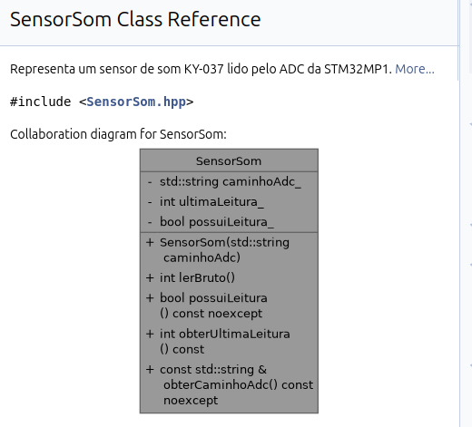
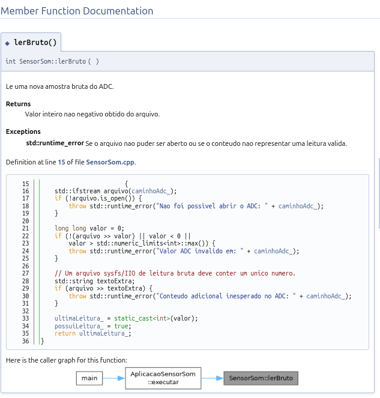

# Sensor de Som KY-037 — STM32MP1-DK1

## Objetivo e escopo da Entrega 1

Projeto da disciplina **Programação Aplicada à Engenharia Elétrica**. Esta etapa implementa, em C++ orientado a objetos, uma classe encapsulada e documentada com Doxygen para ler a saída analógica do KY-037 pelo arquivo ADC do Linux IIO. O programa de exemplo executa uma leitura e mostra a contagem bruta; esse valor **não é uma medida em decibéis (dB)**.

**Estado da Entrega 1:** código e documentação preparados; compilação e testes locais verificados com dados simulados. A leitura do sensor físico na STM32MP1-DK1 será validada na Entrega 2.

## Estrutura do projeto

- `include/SensorSom.hpp`: declaração da classe, atributos privados, métodos públicos e comentários Doxygen.
- `src/SensorSom.cpp`: leitura de arquivo Linux IIO, tratamento de erros e armazenamento da última leitura válida.
- `main.cpp`: aplicacao minima que utiliza a classe; toda a logica fica encapsulada em classes.
- `testes/teste_sensor_som.cpp`: teste local com arquivo simulado e tratamento de entrada invalida.
- `dados/leitura_exemplo.txt`: valor ficticio `88` usado somente no teste.
- `Doxyfile`: configuracao do gerador Doxygen, incluindo membros privados, navegador de codigo e diagramas Graphviz.
- `DOCUMENTACAO.md`: pagina inicial da documentacao gerada.

### Classes e métodos

- `SensorSom`: recebe o caminho do arquivo ADC no construtor. `lerBruto()` abre o arquivo, valida um inteiro não negativo e guarda a última leitura válida. `possuiLeitura()`, `obterUltimaLeitura()` e `obterCaminhoAdc()` consultam o estado sem expor os atributos privados.
- `AplicacaoSensorSom` (em `main.cpp`): escolhe o arquivo ADC, usa `SensorSom` para fazer uma leitura, imprime o resultado e informa erros de execução.
- `TesteSensorSom` (em `testes/teste_sensor_som.cpp`): verifica leitura simulada, estado inicial e preservação da última leitura quando a entrada é inválida.

Não há variáveis globais; a lógica da aplicação e dos testes está encapsulada nas classes.

## Dependências

- Ubuntu ou outro Linux com `g++` e suporte a C++17 para compilar e executar os testes locais.
- `doxygen` e `graphviz` (`dot`) para gerar a documentação HTML e os diagramas.
- Para etapas posteriores na placa: SDK/compilador cruzado `arm-buildroot-linux-gnueabihf-g++` compatível com o Linux embarcado e acesso serial ou SSH.

## Compilacao e teste no Ubuntu (sem hardware)

```bash
g++ -std=c++17 -Wall -Wextra -Wpedantic -Iinclude src/SensorSom.cpp main.cpp -o sensor_som
./sensor_som dados/leitura_exemplo.txt
```

Saída verificada com o arquivo simulado:

```text
Fonte: dados/leitura_exemplo.txt
Leitura bruta do ADC: 88
```

Testes automatizados:

```bash
g++ -std=c++17 -Wall -Wextra -Wpedantic -Iinclude src/SensorSom.cpp testes/teste_sensor_som.cpp -o teste_sensor_som
./teste_sensor_som
```

Saída verificada dos testes locais:

```text
Testes locais: OK
```

O argumento de `sensor_som` é o caminho de um arquivo com uma leitura inteira. Sem argumento, o programa usa `/sys/bus/iio/devices/iio:device0/in_voltage13_raw`, disponível apenas na placa configurada. Os valores do arquivo de exemplo e dos testes **não são medições do KY-037**.

## Compilacao cruzada para STM32 (a validar na placa)

No Ubuntu, com o SDK fornecido pelo professor extraido:

```bash
SDK="$HOME/Downloads/arm-buildroot-linux-gnueabihf_sdk-buildroot"
"$SDK/bin/arm-buildroot-linux-gnueabihf-g++" -std=c++17 -Wall -Wextra -Wpedantic -Iinclude src/SensorSom.cpp main.cpp -o sensor_som_arm
file sensor_som_arm
```

Esses comandos mostram como gerar um binário ARM com o SDK fornecido. A execução na placa e a leitura do KY-037 ainda precisam ser testadas na Entrega 2; a compatibilidade do binário com o Linux instalado no kit não foi confirmada aqui.

## Canal ADC identificado no laboratorio

- Entrada fisica escolhida: **A4**.
- Dispositivo IIO: `iio:device0` (nome `48003000.adc:adc@0`).
- Canal: `in_voltage13_raw`.
- Caminho completo: `/sys/bus/iio/devices/iio:device0/in_voltage13_raw`.
- Leituras ja observadas com **A4 conectado ao GND**: `56, 88, 0, 72, 0, 0` (contagens brutas), e escala `0.038146972` com offset `0`.
- As observacoes acima **nao sao leituras do KY-037**.

A aplicacao usa esse caminho por padrao, ou outro indicado como argumento na linha de comando.

## Documentacao Doxygen

Instale Doxygen e Graphviz no Ubuntu (caso ainda nao estejam instalados):

```bash
sudo apt-get update
sudo apt-get install doxygen graphviz
```

Na raiz do projeto, execute:

```bash
doxygen --version
dot -V
doxygen Doxyfile
```

Abra `docs/html/index.html` no navegador. Confira as paginas das classes
`SensorSom` e `AplicacaoSensorSom`, os metodos, os atributos privados e os
arquivos-fonte. O arquivo `Doxyfile` ativa opcoes sugeridas nos slides da
disciplina: `EXTRACT_PRIVATE`, `EXTRACT_STATIC`, `SOURCE_BROWSER`,
`INLINE_SOURCES`, `HAVE_DOT`, `UML_LOOK` e `DOT_UML_DETAILS`.

### Evidências da Entrega 1

As imagens abaixo foram obtidas da documentação Doxygen
gerada no Ubuntu.

**Diagrama UML da classe SensorSom:**



**Documentação dos métodos:**



A documentação HTML completa pode ser gerada com
`doxygen Doxyfile`. A pasta `docs/` não é
versionada no Git: os comentários Doxygen estão nos arquivos-fonte, e o `Doxyfile` permite recriar o HTML. A saída dos testes locais está registrada acima.

## Modelo da classe

```text
SensorSom
--------------------------------
- caminhoAdc_: std::string
- ultimaLeitura_: int
- possuiLeitura_: bool
--------------------------------
+ SensorSom(caminhoAdc)
+ lerBruto(): int
+ possuiLeitura(): bool
+ obterUltimaLeitura(): int
+ obterCaminhoAdc(): const string&
```

## Próxima etapa

1. Executar o programa na STM32 e validar a leitura real do KY-037.
2. Realizar testes com diferentes níveis de ruído.
3. Analisar os valores obtidos pelo ADC e verificar o comportamento do sensor.
4. Registrar os resultados e as evidências no GitHub.

As leituras reais também serão contagens brutas do ADC, não valores calibrados em dB.

## Protocolo

Ainda nao implementado — pertence a entrega de comunicacao UDP.

## Autoria e colaboracao

Implementacao inicial disponibilizada para revisao e continuidade pelo grupo. O GitHub deve registrar os commits de cada integrante. Os resultados e fotos devem corresponder apenas a testes realmente realizados.
