# Sensor de Som KY-037 — STM32MP1-DK1

Veja a interface recebendo leituras do sensor e atualizando o gráfico em tempo real. A [demonstração completa em vídeo](https://drive.google.com/file/d/1BVW8qoyFHY4mEYED9KS1cEBujymM_ru7/view?usp=sharing) mostra o projeto em funcionamento.

<a href="evidencias/entrega5/interface.gif">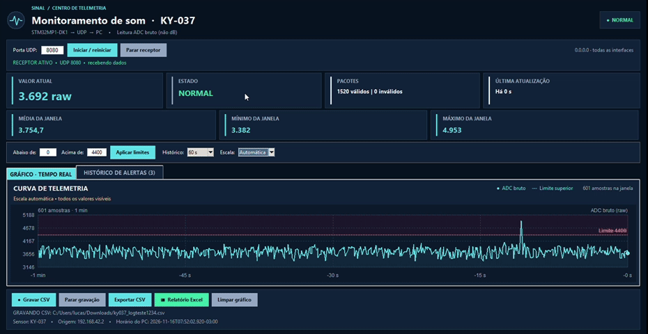</a>

## Sumário do projeto e funcionamento

Comece por estas seções para entender o sensor, a organização do código e como compilar e executar o sistema. Os tópicos extensos podem ser abertos conforme a necessidade.

- [Visão geral](#objetivo)
- [Sensor e funcionamento](#sensor)
- [Estrutura do projeto](#estrutura)
- [Dependências](#dependencias)
- [Compilação e testes no Ubuntu (sem hardware)](#compilacao-local)
- [Compilação cruzada para STM32](#compilacao-stm32)
- [Canal ADC utilizado](#canal-adc)
- [Arquitetura e diagramas](#modelo-e-diagramas)
- [Documentação do código](#documentacao)
- [Comunicação UDP](#comunicacao-udp)
- [Interface de monitoramento](#interface)
- [Medições e resultados](#resultados)
- [Autoria e colaboração](#autoria)

## Sumário dos entregáveis

O histórico começa aberto para que os links levem diretamente a cada entrega. Use o título do bloco para recolhê-lo quando desejar.

- [Histórico das entregas e evidências](#historico-entregas)
  - [Entrega 0 — Conexão física](#entrega-0)
  - [Entrega 1 — Classe e Doxygen](#entrega-1)
  - [Entrega 2 — Resultados experimentais](#entrega-2)
  - [Entrega 3 — Comunicação UDP](#entrega-3)
  - [Entrega 4 — Interface gráfica](#entrega-4)
  - [Entrega 5 — Demonstração](#entrega-5)

<a id="objetivo"></a>

## Visão geral

O sistema lê a saída analógica do KY-037 na STM32MP1-DK1 e envia as amostras por UDP a um computador. A interface no PC apresenta o valor atual, o histórico gráfico e alertas por limites configuráveis; também grava CSV e gera relatório Excel.

A aplicação embarcada é escrita em C++ e usa o subsistema IIO do Linux. O receptor e a interface são escritos em Python 3. Os valores são **contagens brutas do ADC (raw)**, não decibéis; o sistema não grava áudio. A leitura, a comunicação e a interface foram demonstradas com dados reais do sensor. O GIF acima e o [vídeo de demonstração](https://drive.google.com/file/d/1BVW8qoyFHY4mEYED9KS1cEBujymM_ru7/view?usp=sharing) mostram a execução.

<a id="sensor"></a>

## Sensor e funcionamento

Entenda como o KY-037 funciona e como sua saída analógica se liga à STM32.

Antes de alterar a fiação, desligue o kit. A [foto da montagem usada no ensaio](evidencias/entrega0/conexao_ky037_stm32_energizado.png) mostra a placa energizada.

O módulo KY-037 capta som por um microfone e disponibiliza um sinal elétrico na saída analógica **AO**. Neste projeto, `+` é ligado a **3,3 V**, `G` a **GND** e `AO` à entrada **A4** da STM32MP1-DK1. A saída digital `DO` não é usada. O Linux disponibiliza a contagem do ADC pelo subsistema IIO; `SensorSom` abre o arquivo correspondente a cada amostra. O programa não converte essa contagem para tensão ou dB e não captura áudio. O intervalo pedido entre amostras pode variar por causa do escalonamento do Linux e da leitura do arquivo.

<a id="estrutura"></a>

## Estrutura do projeto

Consulte a árvore de arquivos e o papel das classes e métodos do sistema.

<details>
<summary>Ver estrutura do código e classes</summary>

```text
.
├── README.md                    Visão geral, uso e resultados
├── Makefile                     Compilação, testes e documentação
├── Doxyfile                     Configuração do Doxygen
├── main.cpp                     Interface de linha de comando C++
├── servidor_udp.py              Receptor UDP em terminal
├── interface_grafica.py         Interface Tkinter no PC
├── telemetria_gui.py            Classes de protocolo, histórico, alertas e CSV da GUI
├── relatorio_excel.py           Exportador OOXML / Excel com gráfico e alertas
├── include/                     Declarações das classes C++
│   ├── SensorSom.hpp
│   ├── MonitoramentoSom.hpp
│   ├── ProtocoloSom.hpp
│   └── ClienteUDP.hpp
├── src/                         Implementações correspondentes
│   ├── SensorSom.cpp
│   ├── MonitoramentoSom.cpp
│   ├── ProtocoloSom.cpp
│   └── ClienteUDP.cpp
├── testes/                      Testes locais de leitura, monitoramento e UDP
│   ├── teste_sensor_som.cpp
│   ├── teste_monitoramento_som.cpp
│   ├── teste_protocolo_udp.cpp
│   ├── teste_interface_udp.py    Testes do protocolo/histórico/rede/CSV (Python)
│   ├── teste_melhorias_interface.py  Estatísticas, escala e alertas
│   ├── teste_historico_longo.py     Histórico de 30 min e preservação de picos
│   ├── teste_relatorio_excel.py     Integridade do XLSX e gráfico
│   ├── teste_limpeza_alertas.py     Painel por gravação sem excluir CSV
│   ├── teste_layout_janela.py      Layout em janela reduzida (exige display)
│   ├── teste_gui_smoke.py          Abertura e alerta da GUI (exige display)
│   └── emissor_teste_udp.py     Emissor de dados SIMULADOS para teste local
├── dados/
│   └── leitura_exemplo.txt      Valor simulado para os testes
└── evidencias/
    ├── entrega0/
    │   └── conexao_ky037_stm32_energizado.png  Foto da montagem durante o ensaio
    ├── entrega1/                Documentação Doxygen e capturas da classe
    │   ├── DOCUMENTACAO.md
    │   ├── INSTRUCOES.md
    │   ├── doxygen_sensor_som.png
    │   └── doxygen_metodos.png
    ├── entrega2/                Roteiro, medições e análise
    │   ├── ROTEIRO_ENTREGA2.md
    │   ├── ANALISE_ENTREGA2.md
    │   ├── silencio.csv
    │   ├── ruido.csv
    │   ├── ky037_comparacao_completa.png
    │   └── ky037_comparacao_ampliada.png
    ├── entrega3/                Capturas da comunicação UDP
    │   ├── terminal_stm32_udp.png
    │   └── servidor_udp_pc.jpg
    ├── entrega4/                Evidências reais da GUI e relatórios
    │   ├── INSTRUCOES.md
    │   ├── entrega4_terminal_stm32.png
    │   ├── entrega4_interface_monitoramento.png
    │   ├── entrega4_interface_alertas.png
    │   ├── entrega4_excel_grafico.png
    │   ├── entrega4_excel_alertas.png
    │   ├── ky037_log1231.csv
    │   └── Relatorio_KY037_1231.xlsx
    └── entrega5/
        └── interface.gif        Demonstração animada da interface
```

O arquivo em `include/` declara cada classe e o arquivo de mesmo nome em `src/` implementa seus métodos. [`DOCUMENTACAO.md`](evidencias/entrega1/DOCUMENTACAO.md) é a página inicial usada pelo Doxygen. O HTML gerado em `docs/html/` e os executáveis compilados não fazem parte dos arquivos versionados.

### Classes e métodos

- `SensorSom`: recebe o caminho do arquivo ADC no construtor. `lerBruto()` abre o arquivo, valida um inteiro não negativo e guarda a última leitura válida. `possuiLeitura()`, `obterUltimaLeitura()` e `obterCaminhoAdc()` consultam o estado sem expor os atributos privados.
- `AplicacaoSensorSom` (em `main.cpp`): configura caminho ADC, intervalo, quantidade de amostras e envio UDP opcional; executa o monitoramento e informa erros.
- `MonitoramentoSom`: `configurarUDP()` associa cliente e protocolo; `executar()` lê periodicamente, exibe as amostras e envia os pacotes quando UDP está ativo.
- `ProtocoloSom`: `empacotar()` acrescenta o horário atual e `empacotarComTimestamp()` permite informar o horário explicitamente; ambos produzem JSON ou CSV.
- `ClienteUDP`: `enviar()` transmite um datagrama; o destrutor fecha o socket.
- `ServidorReceptorUDP` (Python): `iniciar()` escuta a porta, processa e apresenta as mensagens; `fechar()` libera o socket.
- `TesteSensorSom` (em `testes/teste_sensor_som.cpp`): verifica leitura simulada, estado inicial e preservação da última leitura quando a entrada é inválida.
- `InterfaceMonitoramento` e `AplicacaoInterface` (Python): interface Tkinter, atualização por `after()`, controles e alertas.
- `ReceptorUDP`: thread receptora que enfileira datagramas sem acessar widgets Tk.
- `DecodificadorTelemetria` e `LeituraSom`: validação e representação das mensagens JSON/CSV.
- `HistoricoLeituras`: mantém até 30 minutos de leituras, respeitando um limite de memória, com relógio monotônico do PC.
- `GravadorCSV`: gravação contínua em CSV e exportação da janela atual.
- `AnaliseLeituras`: estatísticas de média, mínimo e máximo, escala vertical e redução visual preservando extremos.
- `DetectorEventos`, `HistoricoAlertas` e `EventoAlerta`: detecção por transição de estado, histórico em CSV e separação entre painel da sessão e registros persistidos.
- `RelatorioExcel`: conversão de gravações CSV para planilha `.xlsx` com gráfico editável, todas as leituras e alertas registrados.

O código C++ organiza a lógica da aplicação e dos testes em classes, sem variáveis globais.

</details>

<a id="dependencias"></a>

## Dependências

Confira o que é necessário no computador e na placa para compilar e executar o projeto.

- Ubuntu ou outro Linux com `make`, `g++` e suporte a C++17 para compilar e executar os testes locais; a comunicação usa sockets POSIX.
- `doxygen` e `graphviz` (`dot`) para gerar a documentação HTML e os diagramas.
- Para compilação e execução na placa: SDK `arm-buildroot-linux-gnueabihf-g++` compatível com o Linux embarcado e acesso serial ou SSH.
- Python 3 (somente biblioteca padrão) e rede IPv4 entre computador e placa para executar o receptor UDP.
- **Tkinter** no computador com interface gráfica. No Windows, costuma acompanhar a instalação oficial do Python; no Ubuntu, se necessário: `sudo apt install python3-tk`. Não é preciso instalar Matplotlib/PyQt.
- A placa **não executa Tkinter**: ela executa o programa C++ e envia os dados por UDP.

<a id="compilacao-local"></a>

## Compilação e testes no Ubuntu (sem hardware)

Use estes comandos para compilar, testar e simular uma leitura sem a placa.

```bash
make
make test
make docs
```

O `make test` executa os testes de leitura, monitoramento e UDP em loopback, além de uma aquisição simulada com `dados/leitura_exemplo.txt` (valor fictício `88`). **Esses testes não substituem as medições reais do sensor.**

Para executar apenas uma aquisição simulada:

```bash
./sensor_som dados/leitura_exemplo.txt --amostras 3 --intervalo-ms 1
```

```text
Fonte ADC: dados/leitura_exemplo.txt
amostra,tempo_ms,adc_bruto
1,0,88
2,1,88
3,2,88
```

Os tempos podem variar conforme o sistema. Sem `--arquivo` ou caminho posicional, o programa usa o ADC configurado na STM32.

<a id="compilacao-stm32"></a>

## Compilação cruzada para STM32

Veja como gerar o executável ARM e transferi-lo para a STM32.

No Ubuntu, utilizando o SDK Buildroot fornecido:

```bash
make arm ARM_CXX="$HOME/Downloads/arm-buildroot-linux-gnueabihf_sdk-buildroot/bin/arm-buildroot-linux-gnueabihf-g++"
```

Esse comando produz `sensor_som_arm`. Use a toolchain compatível com o Linux da placa e confirme a arquitetura do executável antes da transferência.

Confirme que `file sensor_som_arm` identifica um executável ARM. Com SSH disponível, transfira o programa do computador para o kit (substitua o IP conforme sua rede):

```bash
scp -O sensor_som_arm root@192.168.42.2:/root/sensor_som_arm
```

<a id="canal-adc"></a>

## Canal ADC utilizado

Confira o canal IIO configurado e as opções para alterar o arquivo ADC.

- Entrada fisica escolhida: **A4**.
- Dispositivo IIO: `iio:device0` (nome `48003000.adc:adc@0`).
- Canal: `in_voltage13_raw`.
- Caminho completo: `/sys/bus/iio/devices/iio:device0/in_voltage13_raw`.
- Leituras ja observadas com **A4 conectado ao GND**: `56, 88, 0, 72, 0, 0` (contagens brutas), e escala `0.038146972` com offset `0`.
- As observacoes acima **nao sao leituras do KY-037**.

A aplicacao usa esse caminho por padrao, ou outro indicado como argumento na linha de comando.
Se a enumeração IIO mudar no kit, informe o novo arquivo com `--arquivo CAMINHO` ou como argumento posicional. Sem opções, o programa coleta **20 amostras** com intervalo solicitado de **200 ms**. `--continuo` coleta até `Ctrl+C` e não pode ser combinado com `--amostras`.

<a id="modelo-e-diagramas"></a>

## Arquitetura e diagramas

Consulte o modelo de `SensorSom`, o fluxograma e o diagrama das classes implementadas.

<details>
<summary>Ver modelo, fluxograma e diagrama de classes</summary>

```text
SensorSom
--------------------------------
- caminhoAdc_: std::string
- ultimaLeitura_: int
- possuiLeitura_: bool
--------------------------------
+ SensorSom(caminhoAdc)
+ lerBruto(): int
+ possuiLeitura(): bool
+ obterUltimaLeitura(): int
+ obterCaminhoAdc(): const string&
```

### Fluxograma da aplicação

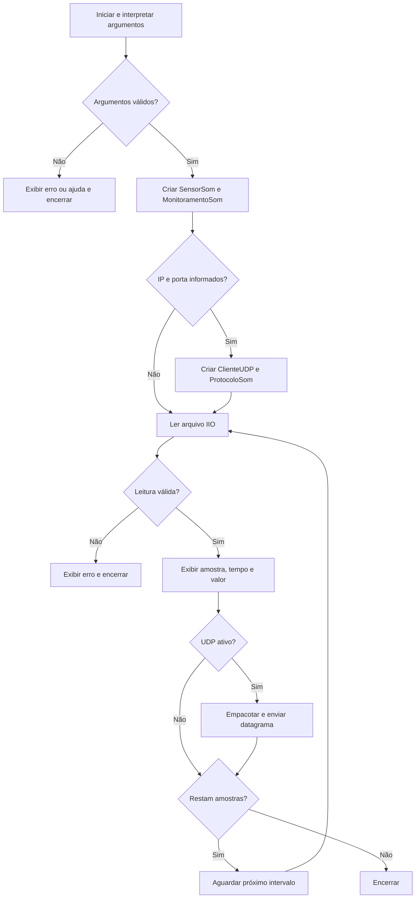

Em `--continuo`, a coleta segue até o processo ser interrompido. Se o envio UDP falhar, a aplicação mostra `[Aviso UDP]` e continua a aquisição.

### Diagrama das classes implementadas

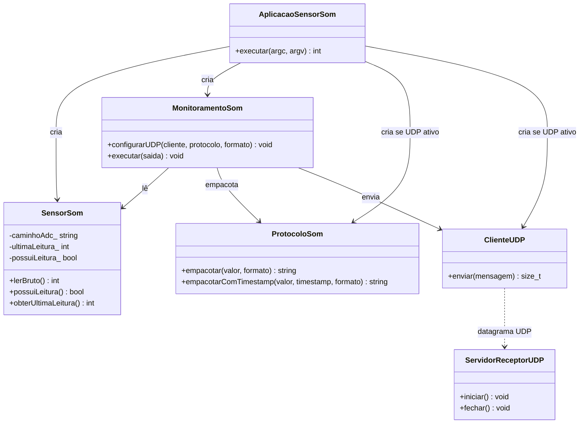

`ServidorReceptorUDP` é uma classe Python no computador; as outras classes deste diagrama são C++. A relação pontilhada representa a comunicação pela rede.

</details>

<a id="documentacao"></a>

## Documentação do código

As classes C++ usam comentários Doxygen, e os módulos Python trazem docstrings. O diagrama acima mostra a relação entre leitura, monitoramento, empacotamento e envio.

Instale `doxygen` e `graphviz` (`dot`) no computador e execute `make docs` na raiz do repositório. Abra `docs/html/index.html` no navegador para consultar classes, métodos, atributos e código-fonte. O HTML é gerado localmente e não é versionado; `Doxyfile` e os comentários do código permitem recriá-lo.

<a id="comunicacao-udp"></a>

## Comunicação UDP

Cada leitura válida é transmitida em um datagrama de texto UTF-8. O formato padrão é JSON; CSV pode ser selecionado na linha de comando. A porta e o IP do computador devem coincidir com a configuração do transmissor.

<details>
<summary>Ver protocolo, exemplos e comandos</summary>

| Campo | Tipo | Significado |
|---|---|---|
| `sensor` | texto | Identificador configurado com `--id-sensor`; padrão `KY-037` |
| `valor` | inteiro | Contagem bruta do ADC |
| `unidade` | texto | `raw` |
| `timestamp` | inteiro | Tempo Unix em milissegundos segundo o relógio da placa |

Mensagem JSON (padrão):

```json
{"sensor":"KY-037","valor":3857,"unidade":"raw","timestamp":946686107619}
```

Mensagem CSV (opção `--formato csv`), sem cabeçalho e na ordem `sensor,valor,unidade,timestamp`:

```text
KY-037,3857,raw,946686107619
```

No PC, para receber os pacotes em um terminal:

```bash
python3 servidor_udp.py 8080
```

Na STM32, após transferir o executável, substitua o IP pelo endereço atual do PC:

```bash
/root/sensor_som_arm --ip 192.168.42.1 --porta 8080 --continuo --intervalo-ms 100 --id-sensor KY-037 --formato json
```

`--ip` e `--porta` são usados juntos. O receptor em terminal e a interface gráfica não podem ocupar a mesma porta ao mesmo tempo. UDP não confirma recebimento nem garante entrega ou ordem. O relógio da placa pode estar desajustado; o `timestamp` do pacote não deve ser tratado como hora confiável sem sincronização. O `tempo_ms` mostrado no terminal da placa é o tempo decorrido desde o início do processo.

</details>

<a id="interface"></a>

## Interface de monitoramento

A interface Tkinter recebe os datagramas no computador, apresenta a leitura e o histórico, sinaliza valores fora dos limites definidos e permite salvar as amostras e exportar relatórios.

<details>
<summary>Ver funcionalidades, execução e arquivos gerados</summary>

| Função | Comportamento |
|---|---|
| Leitura e conexão | Valor atual, estado, IP de origem, última atualização e contagem de pacotes válidos e inválidos |
| Gráfico | Janelas de 30 s, 60 s, 5 min, 10 min ou 30 min; escalas automática e ampliada |
| Alertas | Limites inferior e superior configuráveis; eventos `ACIMA`, `ABAIXO` e `NORMALIZADO` |
| Histórico | Média, mínimo e máximo na janela; eventos persistidos em `alertas_ky037.csv` |
| Arquivos | Gravação contínua ou exportação de CSV; relatório `.xlsx` com gráfico editável |

No Linux com ambiente gráfico, na raiz do repositório:

```bash
python3 interface_grafica.py --porta 8080
```

No Windows, com `interface_grafica.py`, `telemetria_gui.py` e `relatorio_excel.py` na mesma pasta:

```powershell
py -3 interface_grafica.py --porta 8080
```

Depois de iniciar a interface, ajuste os limites e clique em **Aplicar limites**. Para registrar uma sessão, clique em **Gravar CSV** e escolha um nome novo; inicie o envio na STM32 com o comando da seção [Comunicação UDP](#comunicacao-udp). Ao terminar, interrompa o envio e clique em **Parar gravação**. **Exportar CSV** salva a janela disponível; **Relatório Excel** transforma uma gravação CSV em planilha, sem precisar de nova transmissão.

O CSV de amostras usa as colunas:

```csv
horario_pc,sensor,valor_adc,unidade,timestamp_placa_ms,ip_origem
```

O relatório Excel tem abas de visão geral, leituras, alertas e série do gráfico. As leituras originais permanecem completas mesmo quando a série desenhada é reduzida para melhorar a visualização. O arquivo `alertas_ky037.csv` acumula eventos; limpar o painel visual não apaga os registros persistidos. Uma gravação com nome já existente pode acrescentar linhas ao CSV.

O horário do PC é usado para o eixo temporal porque o relógio da STM32 pode estar desajustado. O limite de alerta é experimental: ultrapassá-lo indica uma leitura anômala, sem calibrar o sensor em dB. O receptor UDP e a GUI devem usar portas diferentes quando executados simultaneamente. Para testar a GUI com janela gráfica, execute `make test-gui-smoke` em uma sessão com display e Tkinter.

### Diagrama das classes da interface

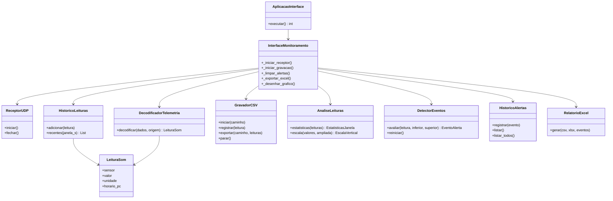

</details>

<a id="resultados"></a>

## Medições e resultados

As leituras reais mostram contagens ADC mais altas e picos mais intensos na condição com ruído. Os números descrevem o ensaio realizado; não representam nível sonoro em decibéis nem um limiar universal para detectar violação.

Em duas séries de 100 amostras, com intervalo solicitado de 100 ms:

| Indicador (ADC raw) | Silêncio | Ruído |
|---|---:|---:|
| Média | 4.137,13 | 5.111,61 |
| Mediana | 4.173 | 4.408,5 |
| Mínimo | 3.522 | 3.190 |
| Máximo | 4.561 | 41.204 |

[Dados em silêncio](evidencias/entrega2/silencio.csv) · [Dados com ruído](evidencias/entrega2/ruido.csv) · [Gráfico comparativo](evidencias/entrega2/ky037_comparacao_completa.png) · [Análise detalhada](evidencias/entrega2/ANALISE_ENTREGA2.md).

Outra [gravação real de 357 leituras](evidencias/entrega4/ky037_log1231.csv), recebidas via UDP em 35,598 s, teve média de **3.939,48**, mínimo de **3.313** e máximo de **14.381 ADC raw**. Dezesseis leituras ficaram acima do limite experimental de **4.400**. O [relatório Excel](evidencias/entrega4/Relatorio_KY037_1231.xlsx) inclui gráfico, todas as amostras e eventos persistidos. As capturas da interface e esse CSV podem pertencer a sessões distintas; os contadores de uma captura não devem ser interpretados como quantidade de linhas do arquivo.

A aquisição perto de 10 Hz não reconstrói a forma de onda do áudio e pode deixar de registrar transientes curtos. O horário do PC é a referência temporal para essas medições.

<a id="historico-entregas"></a>

## Histórico das entregas

As seções seguintes organizam as evidências por etapa. A descrição do sistema, o protocolo, as instruções de uso e os resultados estão nas seções gerais acima. Clique em uma imagem para abri-la no tamanho original.

<details open>
<summary>Ver todas as entregas e evidências</summary>

<a id="entrega-0"></a>

## Entrega 0 — Conexão física do sensor

Consulte a foto da montagem usada no ensaio e a observação sobre a foto exigida com o kit desligado.

<a id="entrega-0-foto"></a>

### Foto da montagem

<a href="evidencias/entrega0/conexao_ky037_stm32_energizado.png">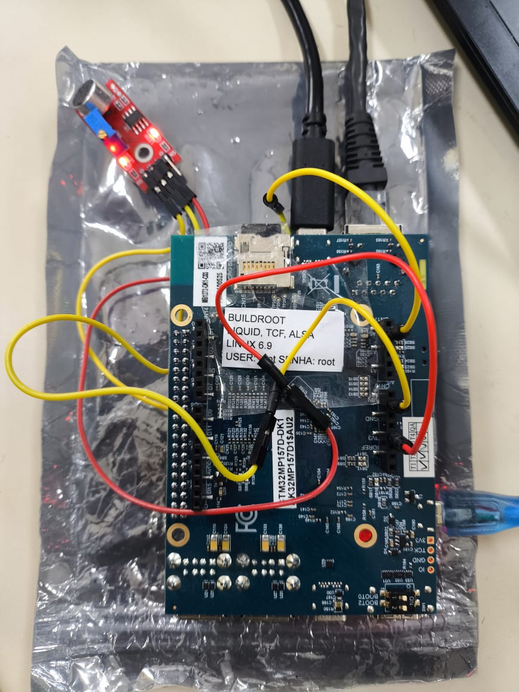</a>

A foto mostra o conjunto **energizado**. Ela documenta a montagem usada no ensaio, mas não substitui a foto com o kit **desligado** exigida antes dos testes pelo enunciado. Nessa montagem, `+` vai a 3,3 V, `G` a GND e `AO` a A4; a saída `DO` fica livre.


<a id="entrega-1"></a>

## Entrega 1 — Classe C++ e documentação Doxygen

Consulte a documentação da classe de leitura do sensor, os comandos Doxygen e as capturas geradas.

<a id="entrega-1-geracao"></a>

### Geração da documentação

Instale Doxygen e Graphviz no Ubuntu (caso ainda nao estejam instalados):

```bash
sudo apt-get update
sudo apt-get install doxygen graphviz
```

Na raiz do projeto, execute:

```bash
doxygen --version
dot -V
doxygen Doxyfile
```

Abra `docs/html/index.html` no navegador. Confira as paginas das classes
`SensorSom` e `AplicacaoSensorSom`, os metodos, os atributos privados e os
arquivos-fonte. O arquivo `Doxyfile` ativa opcoes sugeridas nos slides da
disciplina: `EXTRACT_PRIVATE`, `EXTRACT_STATIC`, `SOURCE_BROWSER`,
`INLINE_SOURCES`, `HAVE_DOT`, `UML_LOOK` e `DOT_UML_DETAILS`.

<a id="entrega-1-evidencias"></a>

### Evidências da Entrega 1

As imagens abaixo foram obtidas da documentação Doxygen
gerada no Ubuntu.

**Diagrama UML da classe SensorSom:**

<a href="evidencias/entrega1/doxygen_sensor_som.png">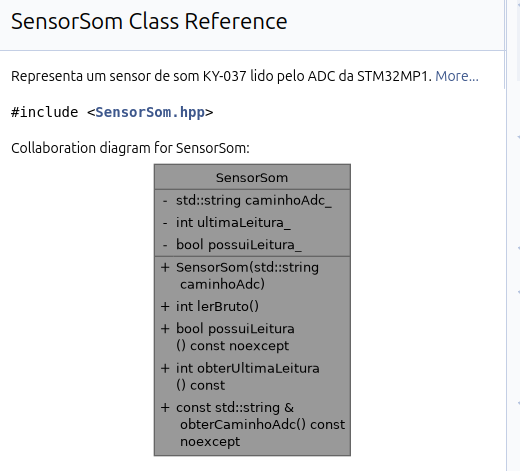</a>

**Documentação dos métodos:**

<a href="evidencias/entrega1/doxygen_metodos.png">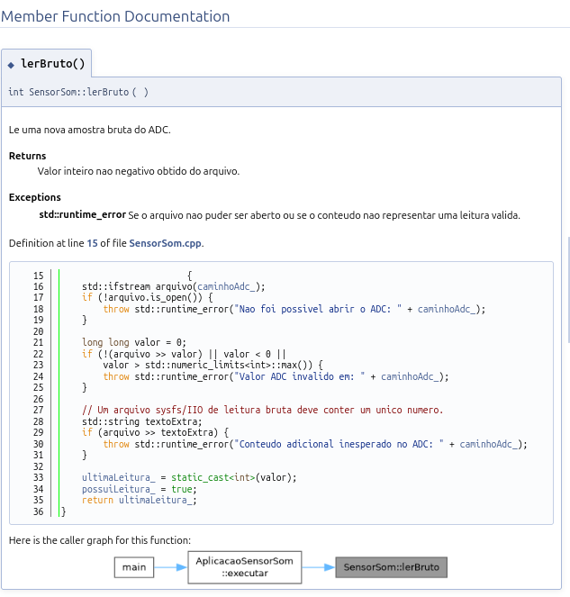</a>

A documentação HTML completa pode ser gerada com
`doxygen Doxyfile`. A pasta `docs/` não é
versionada no Git: os comentários Doxygen estão nos arquivos-fonte, e o `Doxyfile` permite recriar o HTML. A saída dos testes locais está registrada acima.


<a id="entrega-2"></a>

## Entrega 2 — Resultados experimentais

Compare as medições em silêncio e com ruído, com gráficos e instruções de reprodução.

<a id="entrega-2-medicoes"></a>

### Comparação das medições

O programa foi executado na STM32MP1-DK1 com o sensor
KY-037 conectado à entrada analógica A4.

Foram realizadas 100 leituras em silêncio e 100 com ruído,
utilizando intervalo solicitado de 100 ms.

| Indicador | Silêncio | Ruído |
|---|---:|---:|
| Média | 4.137,13 | 5.111,61 |
| Mediana | 4.173 | 4.408,5 |
| Mínimo | 3.522 | 3.190 |
| Máximo | 4.561 | 41.204 |

O teste com ruído apresentou picos mais elevados.
Esses valores representam contagens brutas do ADC,
não níveis sonoros em decibéis.

<a id="entrega-2-evidencias"></a>

### Evidências

<a href="evidencias/entrega2/ky037_comparacao_completa.png">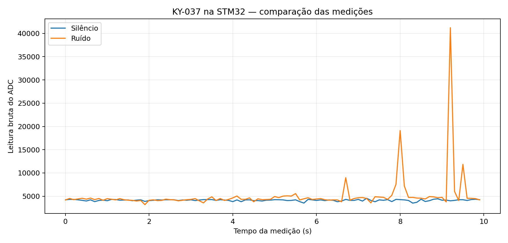</a>

<a href="evidencias/entrega2/ky037_comparacao_ampliada.png">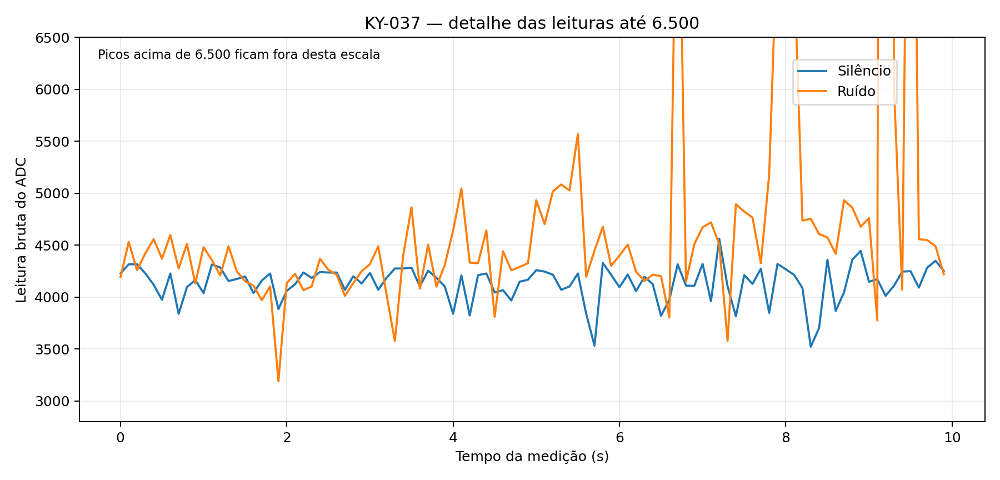</a>

[Análise detalhada](evidencias/entrega2/ANALISE_ENTREGA2.md) · [Roteiro para reproduzir a aquisição](evidencias/entrega2/ROTEIRO_ENTREGA2.md)

<a id="entrega-2-execucao"></a>

### Execução na STM32

Para executar o programa após transferi-lo para a placa:

    cd /root
    chmod +x sensor_som_arm
    ./sensor_som_arm --amostras 100 --intervalo-ms 100


<a id="entrega-3"></a>

## Entrega 3 — Comunicação e protocolo UDP

Veja o formato dos pacotes, os comandos de transmissão e as capturas da comunicação real.

Nesta etapa, implementou-se o envio de cada amostra do sensor KY-037 a partir do kit STM32MP1-DK1 para um receptor no computador via socket UDP.

<a id="entrega-3-arquitetura"></a>

### Arquitetura orientada a objetos (C++)

- `include/ClienteUDP.hpp` e `src/ClienteUDP.cpp`: classe encapsulada com RAII para gerenciamento do socket UDP POSIX (`socket`, `sendto`, `close`), tratamento de exceções e sem variáveis globais no código C++.
- `include/ProtocoloSom.hpp` e `src/ProtocoloSom.cpp`: classe responsável pela formatação e montagem dos pacotes nos formatos JSON (padrão) e CSV.
- `include/MonitoramentoSom.hpp` e `src/MonitoramentoSom.cpp`: integração do laço temporal de aquisição com o envio UDP concorrente à exibição local.
- `main.cpp`: expansão da CLI com os parâmetros `--ip`, `--porta`, `--id-sensor`  e `--formato`.
- `servidor_udp.py`: receptor em Python para validação e recepção no computador do operador.
- `testes/teste_protocolo_udp.cpp`: testes unitários de serialização e envio/recepção em loopback (`127.0.0.1`).

<a id="entrega-3-protocolo"></a>

### Especificação do Protocolo de Mensagens

Cada amostra enviada produz um datagrama UDP de texto UTF-8 com os campos `sensor`, `valor`, `unidade` e `timestamp`. UDP não confirma recebimento nem garante entrega ou ordem:

| Campo | Tipo | Descrição | Exemplo |
| :--- | :--- | :--- | :--- |
| `sensor` | `string` | Identificador único do sensor/grupo | `"KY-037"` |
| `valor` | `inteiro` | Leitura bruta do ADC (`in_voltage13_raw`) | `3857` |
| `unidade` | `string` | Unidade da grandeza lida | `"raw"` |
| `timestamp` | `inteiro (ms)`| Tempo Unix em milissegundos segundo o relógio da placa | `946686107619` |


<a id="entrega-3-json"></a>

#### Formato JSON (padrão):
```json
{"sensor":"KY-037","valor":3857,"unidade":"raw","timestamp":946686107619}
```


<a id="entrega-3-csv"></a>

#### Formato CSV (alternativo, ordem `sensor,valor,unidade,timestamp`, sem cabeçalho):
```text
KY-037,3857,raw,946686107619
```


<a id="entrega-3-execucao"></a>

### Instruções de execução

Confira o endereço IPv4 do computador conectado à STM32 (no Windows, `ipconfig`). Esse endereço deve ser informado em `--ip`, e a porta UDP deve ser a mesma nos dois lados.

1. **No computador (servidor receptor):**
   ```bash
   python3 servidor_udp.py 8080
   ```

2. **Na STM32MP1-DK1 (transmissor):**
   ```bash
   cd /root
   chmod +x sensor_som_arm
   ./sensor_som_arm --ip 192.168.42.10 --porta 8080 --amostras 30 --intervalo-ms 100
   ```

No teste documentado, o computador utilizou `192.168.42.10`; substitua-o pelo IP atual do receptor, caso seja diferente.
Use `--formato csv` para enviar CSV; o receptor o exibe como texto. Use `--id-sensor NOME` para mudar a identificação. `--ip` e `--porta` precisam ser informados juntos. O receptor mostra as mensagens no terminal e não implementa gráficos ou alertas.

**Observação:** na captura do teste, o relógio da STM32 não estava sincronizado; o `timestamp` demonstra o formato do pacote, mas não corresponde à data real da aquisição.
O `tempo_ms` da saída local é o tempo decorrido desde o início do programa e não equivale ao `timestamp` Unix da mensagem.

<a id="entrega-3-evidencias"></a>

### Evidências da Execução Real no Kit STM32

Os testes foram realizados conectando a STM32MP1-DK1 (`192.168.42.2`) ao computador (`192.168.42.10`) via cabo Ethernet:

**1. Execução no terminal da STM32MP1-DK1 (TeraTerm via Serial):**

<a href="evidencias/entrega3/terminal_stm32_udp.png">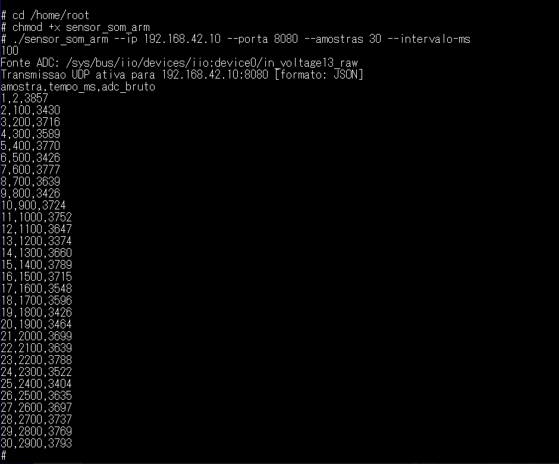</a>

**2. Recepção em tempo real no servidor central (PC:)**

<a href="evidencias/entrega3/servidor_udp_pc.jpg">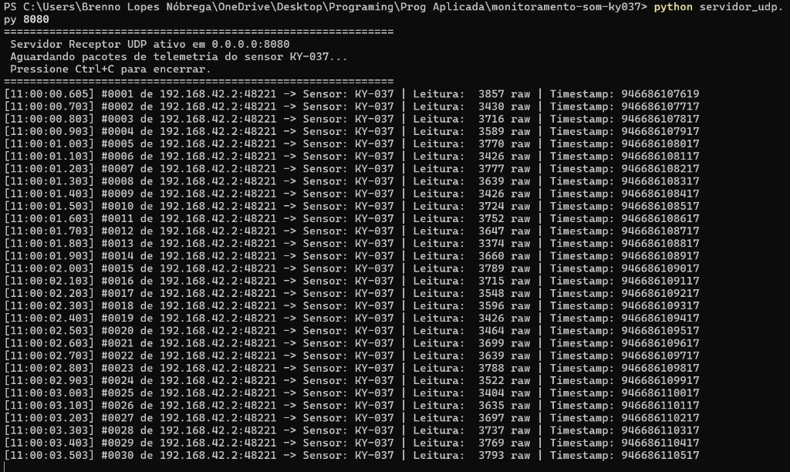</a>

Na execução documentada, o servidor recebeu 30 mensagens enviadas pela STM32. O UDP não garante a entrega de todos os pacotes em qualquer condição de rede.


<a id="entrega-4"></a>

## Entrega 4 — Interface gráfica de monitoramento no computador

Conheça a interface, o uso no PC, o CSV, as medições reais e os testes. O GIF está visível no início desta página.

<a id="entrega-4-resultado"></a>

### Resultado obtido

A interface **Python 3 / Tkinter** recebeu por **UDP (porta 8080)** leituras **reais** do KY-037, ligado à STM32MP1-DK1. O terminal da placa, a janela da interface e o relatório Excel estão documentados com capturas reais abaixo. A STM32 executa o **programa C++ em Linux embarcado**; a interface e o relatório são executados no **PC**. O receptor `servidor_udp.py` da Entrega 3 e a interface gráfica não devem ocupar a mesma porta simultaneamente.

**Observação sobre as evidências:** as capturas do Tera Term, da interface gráfica e o CSV anexado podem ter sido obtidos em **sessões distintas**. Na captura da GUI, por exemplo, o contador total indica **5.288 pacotes válidos** desde a abertura, enquanto o CSV `ky037_log1231.csv` contém **357 leituras de uma gravação específica**. Não interpretar esses valores como contagens da mesma sessão.

<a id="entrega-4-funcionalidades"></a>

### Funcionalidades implementadas

| Função | Comportamento |
|---|---|
| Leitura em tempo real | Mostra contagem ADC atual, estado da conexão, IP de origem, último recebimento e quantidade de pacotes válidos/inválidos. |
| Gráfico temporal | Histórico selecionável: **30 s, 60 s, 5 min, 10 min ou 30 min**; escala **Automática** ou **Ampliada**. A curva persiste após o término do envio enquanto a interface permanecer aberta. |
| Escala ampliada | Valoriza a faixa usual das medições e sinaliza os picos fora da área visível; os valores originais permanecem no histórico e no CSV. |
| Estatísticas | Média, mínimo e máximo das leituras na janela selecionada. |
| Alerta visual | Indica leitura acima/abaixo de limites configuráveis por **Aplicar limites**. Os eventos são gerados nas mudanças de estado (`ACIMA`, `ABAIXO`, `NORMALIZADO`). |
| Histórico por gravação | Ao iniciar **Gravar CSV** com sucesso, a **lista visual** de alertas começa vazia. **Zerar painel (preserva CSV)** limpa só a tela. Nenhuma dessas ações apaga ou reescreve os alertas já salvos no arquivo histórico. |
| Registro permanente de alertas | O arquivo **`alertas_ky037.csv`** no diretório de trabalho acumula os eventos de várias sessões; novos eventos são acrescentados. O painel visual e o reconhecimento não alteram os registros anteriores. |
| Gravação de amostras | **Gravar CSV**, **Parar gravação** e **Exportar CSV**. A gravação salva as leituras válidas à medida que chegam; a exportação manual salva a janela disponível. |
| Relatório Excel | **Relatório Excel** converte um CSV gravado em `.xlsx`, com abas de visão geral, leituras, alertas e série do gráfico. O gráfico é editável no Excel e não rotula individualmente centenas de pontos. |

As unidades são **contagens brutas ADC (`raw`)**, **não decibéis (dB)**. Os limiares são **experimentais**, não uma calibração acústica nem prova automática de violação da carga. O recebimento ocorre por UDP, que não garante entrega. O relógio da STM32 pode estar desajustado; para as medições anexadas, o **horário do PC** é a referência temporal confiável. A aquisição a aproximadamente 10 Hz não representa a forma de onda completa do áudio e pode não capturar transientes curtos.

<a id="entrega-4-execucao"></a>

### Executar a interface no PC e na STM32

**No Windows (PowerShell, pasta com os três arquivos Python):**

```powershell
cd C:\Compartilhada_EE
py -3 interface_grafica.py --porta 8080
```

Se executar pelo próprio repositório em vez da pasta compartilhada, entre primeiro na pasta correspondente. Os arquivos `interface_grafica.py`, `telemetria_gui.py` e `relatorio_excel.py` precisam estar juntos. O Python padrão para Windows inclui `tkinter` na instalação usual. No Ubuntu gráfico, use `python3 interface_grafica.py --porta 8080`; se faltar `tkinter`, instale `python3-tk` compatível com o Python utilizado. Não são necessárias bibliotecas externas como Matplotlib, `openpyxl` ou `xlsxwriter` para executar a aplicação.

**Preparação física:** com o kit desligado para qualquer alteração de fios, KY-037 `+` em **3,3 V**, `G` em **GND** e `AO` em **A4**; `DO` não é utilizado. Conectar a Ethernet da placa ao PC e conferir a comunicação. Na configuração testada, a placa usou `192.168.42.2` e a Ethernet do PC `192.168.42.1`, sujeitos a alterações em outras redes.

**Na STM32 (Tera Term, prompt `#`):**

```bash
/root/sensor_som_arm --ip 192.168.42.1 --porta 8080 --continuo --intervalo-ms 100 --id-sensor KY-037 --formato json
```

Esse comando utiliza a versão C++ com UDP da Entrega 3. Para encerrar o envio, pressione **Ctrl+C no Tera Term**. Se for necessário transferir o binário ARM a partir do Windows, use `scp -O` e confira a assinatura SSH da placa antes de aceitar chaves alteradas. O comando de ajuda na placa é `/root/sensor_som_arm --ajuda` (não `--help`).

**Procedimento de gravação:** abra a interface, defina os limites e clique em **Aplicar limites**; selecione a janela temporal; clique em **Gravar CSV** e salve com um **nome novo**; inicie a STM32; depois interrompa a transmissão e clique em **Parar gravação**. A criação de uma nova gravação zera **apenas os alertas mostrados no painel**, preservando `alertas_ky037.csv`. Não reutilize o nome do CSV para sessões diferentes, pois a gravação pode acrescentar linhas ao arquivo existente.

<a id="entrega-4-arquivos"></a>

### Formato do arquivo CSV e do relatório Excel

O CSV de leituras possui as colunas:

```csv
horario_pc,sensor,valor_adc,unidade,timestamp_placa_ms,ip_origem
```

O botão **Relatório Excel** permite selecionar uma gravação `.csv` já realizada e gerar `.xlsx`, sem nova transmissão da STM32. O arquivo contém:

- **Visao Geral** — resumo estatístico, horários da sessão, referência de limites e gráfico XY editável de ADC bruto versus tempo transcorrido;
- **Leituras** — todas as amostras válidas do CSV de origem, sem eliminar os picos;
- **Alertas** — eventos realmente presentes no log persistente da GUI, distinguindo os da gravação escolhida dos de sessões anteriores;
- **Serie Grafico** — pontos utilizados para desenhar a curva. Em arquivos extensos, a quantidade de pontos **do gráfico** pode ser reduzida preservando os extremos; as linhas da aba **Leituras** permanecem intactas.

A linha do limite mostrada no Excel é uma **referência configurada na exportação**; para saber os limites efetivos associados a um alerta histórico, consulte as colunas do próprio evento. A aba **Alertas** não cria alarmes que não foram registrados pela GUI.

<a id="entrega-4-medicoes"></a>

### Medições experimentais documentadas

A gravação real [`ky037_log1231.csv`](evidencias/entrega4/ky037_log1231.csv), de **14/11/2026**, contém:

| Indicador | Resultado |
|---|---:|
| Sensor e origem | `KY-037` / `192.168.42.2` |
| Intervalo medido pelo relógio do PC | `23:41:28.837` a `23:42:04.435` (UTC−03:00) |
| Duração | **35,598 s** |
| Amostras válidas | **357** |
| Média | **3.939,48 ADC raw** |
| Mínimo / máximo | **3.313 / 14.381 ADC raw** |
| Leituras acima de 4.400 | **16** |
| Limite superior da sessão documentada | **4.400 ADC raw** |

O relatório [`Relatorio_KY037_1231.xlsx`](evidencias/entrega4/Relatorio_KY037_1231.xlsx) contém **152 eventos históricos** no total; **32** estão marcados como pertencentes a essa gravação (16 ultrapassagens e 16 normalizações). **Eventos** não são o mesmo que **amostras**: uma passagem para `ACIMA` seguida de retorno à faixa normal gera dois eventos. Os números deste CSV não devem ser confundidos com as contagens da captura de interface obtida em outra ocasião.

<a id="entrega-4-evidencias"></a>

### Evidências reais da Entrega 4

**1. Aquisição na STM32 — terminal serial (Tera Term)**

<a href="evidencias/entrega4/entrega4_terminal_stm32.png">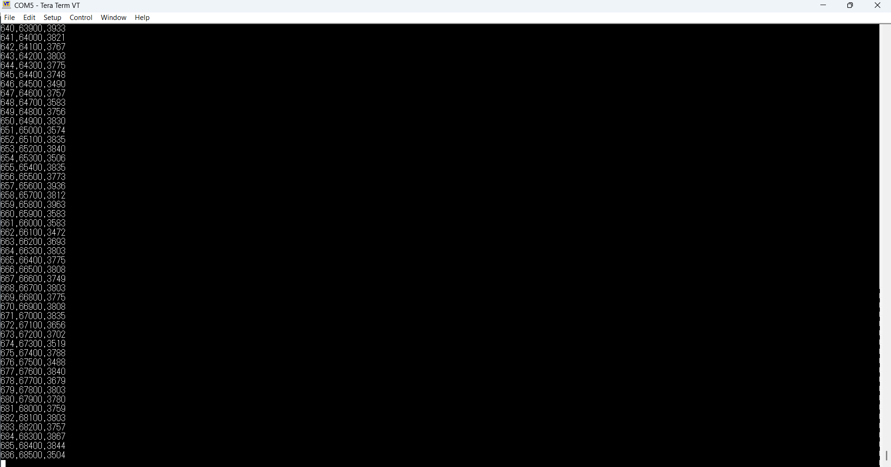</a>

A imagem mostra a sequência de amostras, tempo decorrido e contagens do ADC. **O comando completo com endereço IP e porta UDP não aparece nesta captura**; a comunicação é corroborada pela GUI recebendo pacotes da placa e pelas evidências da Entrega 3.

**2. GUI do PC recebendo UDP e desenhando o gráfico temporal**

<a href="evidencias/entrega4/entrega4_interface_monitoramento.png">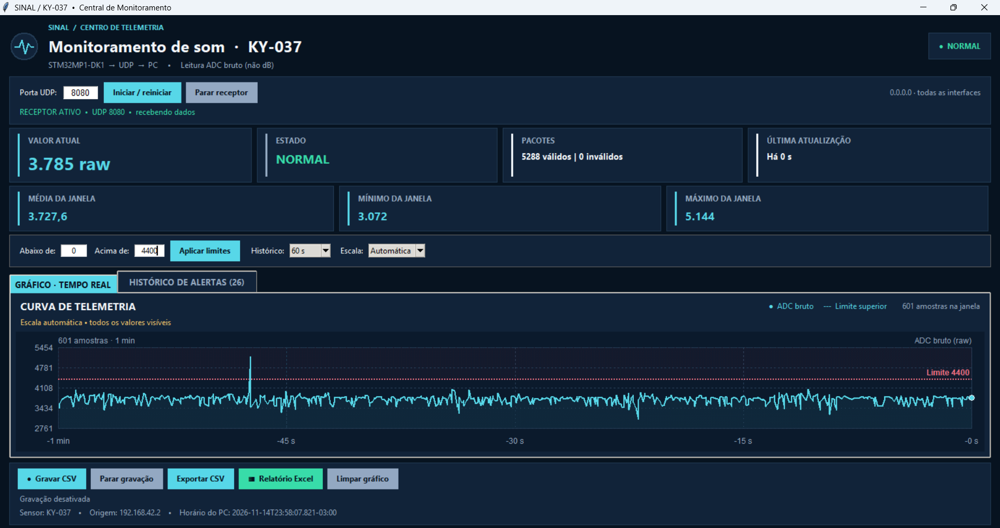</a>

A captura mostra o receptor ativo na porta **8080**, origem **192.168.42.2**, leituras em tempo real, **5.288 pacotes válidos**, gráfico de **60 s** com **601 amostras**, estatísticas e limite superior **4.400 ADC raw**. O contador representa o acumulado desde a inicialização do receptor e **não** o tamanho do CSV anexado.

**3. Histórico visual de ultrapassagens e normalizações**

<a href="evidencias/entrega4/entrega4_interface_alertas.png">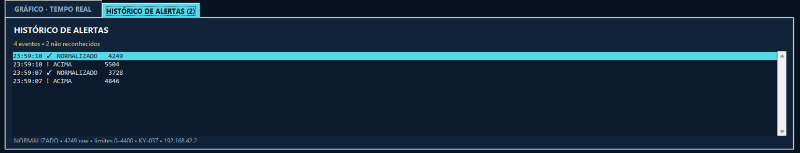</a>

A imagem apresenta eventos `ACIMA` e `NORMALIZADO`, incluindo valores **4.846**, **5.504**, **3.728** e **4.249 ADC raw**, com limite superior **4.400**. A lista visual pertence à sessão em curso e não substitui o arquivo histórico persistente.

**4. Gráfico da gravação exportado para Excel**

<a href="evidencias/entrega4/entrega4_excel_grafico.png">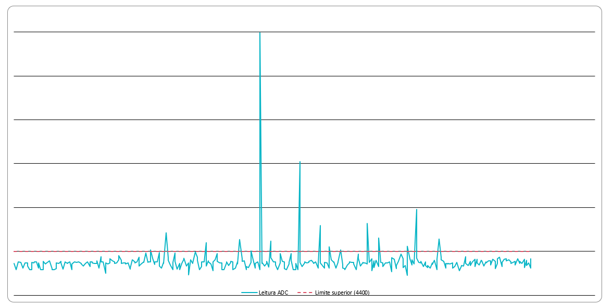</a>

**5. Alertas registrados no relatório Excel**

<a href="evidencias/entrega4/entrega4_excel_alertas.png">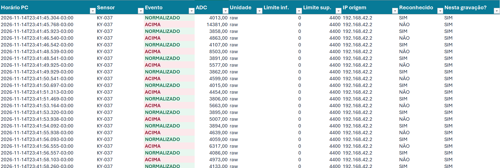</a>

**Arquivos de dados e instruções:** [CSV com 357 leituras](evidencias/entrega4/ky037_log1231.csv) · [Relatório Excel com gráfico e histórico](evidencias/entrega4/Relatorio_KY037_1231.xlsx) · [Procedimento e inventário das evidências](evidencias/entrega4/INSTRUCOES.md).

**Limite de comprovação:** o histórico de 5, 10 e 30 minutos e as funcionalidades de exportação foram implementados e submetidos a testes automatizados, mas **não se afirma aqui que uma aquisição física de 30 minutos tenha sido realizada**. O conjunto de evidências apresenta testes reais mais curtos e outras capturas da interface em funcionamento.

<a id="entrega-4-testes"></a>

### Testes automatizados e organização do código

No **Ubuntu**, o comando `make test` verifica a leitura do ADC simulado, monitoramento, envio UDP, decodificação, histórico de amostras, alertas e relatório Excel. O conjunto de testes atual também inclui a verificação de que **zerar a aba de alertas não apaga o CSV persistente**. Ele requer `tkinter` importável pelo Python usado nos testes. Para testes gráficos que abrem janelas (e exigem display), use `make test-gui-smoke`.

```bash
make test
make test-gui-smoke  # somente em uma sessão gráfica com Tkinter
```

As classes de C++ da STM32 continuam documentadas com Doxygen. As classes Python usam docstrings, encapsulamento e atualização dos widgets na thread da GUI; a recepção UDP opera separadamente.


<a id="entrega-5"></a>

## Entrega 5 — Demonstração e apresentação

Acesse o vídeo, o GIF e as orientações para a apresentação final.

<a id="entrega-5-video-gif"></a>

### Vídeo e GIF

- [Vídeo de demonstração no Google Drive](https://drive.google.com/file/d/1BVW8qoyFHY4mEYED9KS1cEBujymM_ru7/view?usp=sharing).
- [Demonstração animada da interface](evidencias/entrega5/interface.gif).
- O fluxograma, os diagramas de classes, as instruções de compilação e uso, o protocolo, a descrição do sensor, as capturas da interface e a análise das medições estão documentados nas seções anteriores deste README.

<a id="indice-evidencias"></a>

## Índice da documentação e das evidências

Encontre rapidamente os arquivos e registros de cada entrega.

| Etapa | Documentação e evidências disponíveis |
|---|---|
| Entrega 0 | [Foto da montagem física durante o ensaio](evidencias/entrega0/conexao_ky037_stm32_energizado.png); ainda é necessária a foto do kit desligado exigida pelo enunciado, caso não tenha sido enviada separadamente ao professor. |
| Entrega 1 | [Diagrama Doxygen de `SensorSom`](evidencias/entrega1/doxygen_sensor_som.png), [captura dos métodos](evidencias/entrega1/doxygen_metodos.png), [instruções e inventário](evidencias/entrega1/INSTRUCOES.md) e [página inicial do Doxygen](evidencias/entrega1/DOCUMENTACAO.md). |
| Entrega 2 | [Roteiro de reprodução](evidencias/entrega2/ROTEIRO_ENTREGA2.md), [dados em silêncio](evidencias/entrega2/silencio.csv), [dados com ruído](evidencias/entrega2/ruido.csv), gráficos exibidos acima e [análise detalhada](evidencias/entrega2/ANALISE_ENTREGA2.md). |
| Entrega 3 | [Captura do terminal da STM32](evidencias/entrega3/terminal_stm32_udp.png) e [captura do terminal receptor no computador](evidencias/entrega3/servidor_udp_pc.jpg), ambos com os programas em funcionamento. |
| Entrega 4 | [Interface Tkinter](interface_grafica.py), [telemetria e alertas](telemetria_gui.py), [exportador Excel](relatorio_excel.py), [CSV real](evidencias/entrega4/ky037_log1231.csv), [relatório XLSX](evidencias/entrega4/Relatorio_KY037_1231.xlsx), [captura do Tera Term](evidencias/entrega4/entrega4_terminal_stm32.png), [captura da GUI](evidencias/entrega4/entrega4_interface_monitoramento.png) e [histórico de alertas](evidencias/entrega4/entrega4_interface_alertas.png). |
| Entrega 5 | [Vídeo de demonstração](https://drive.google.com/file/d/1BVW8qoyFHY4mEYED9KS1cEBujymM_ru7/view?usp=sharing), [GIF da interface](evidencias/entrega5/interface.gif) e documentação nesta página. |

Os arquivos `silencio.csv` e `ruido.csv` da Entrega 2 começam com a linha `Fonte ADC: ...` antes do cabeçalho CSV. A documentação completa das classes embarcadas pode ser gerada com `make docs`. As capturas reais da Entrega 4 já foram inseridas acima; é necessário **confirmar sua renderização no GitHub após o push** e conferir que os arquivos foram incluídos no commit.

</details>

<a id="autoria"></a>

## Autoria e colaboração

Este projeto foi desenvolvido em grupo por **Quiuqui**, **Miranda** e **Nóbrega**. No histórico Git, suas contribuições aparecem, respectivamente, como `lucasquiuqui`, `fnmiranda` e `brennoln`.

O trabalho reúne a leitura do sensor na STM32, a transmissão UDP, a interface no computador, os testes e a documentação. O [histórico de commits](https://github.com/lucasquiuqui/monitoramento-som-ky037/commits) permite consultar as alterações feitas ao longo do projeto; os arquivos de dados e as capturas documentam os resultados apresentados acima.
