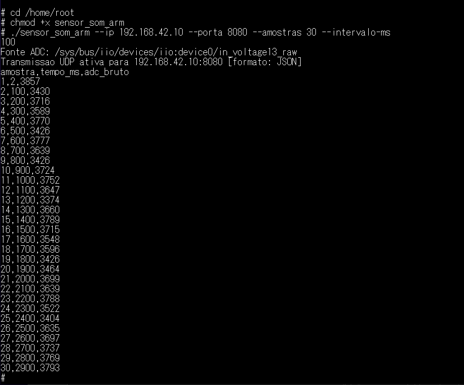
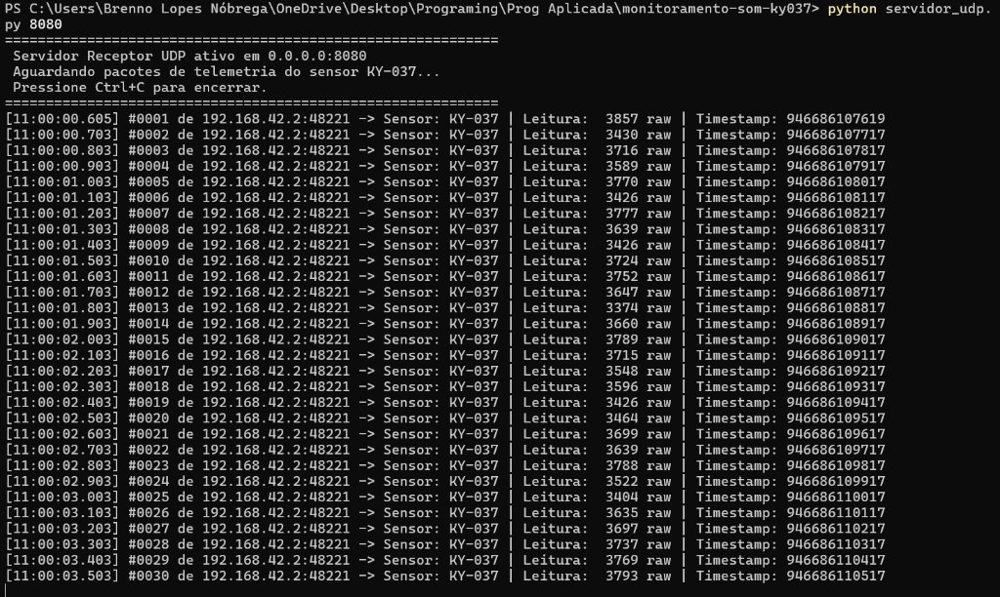

# Sensor de Som KY-037 — STM32MP1-DK1

## Contexto do Projeto

Projeto da disciplina **Programação Aplicada à Engenharia Elétrica** (IME / Exército Brasileiro) — *Monitoramento Inteligente de Carga*. Esta aplicação implementa o subsistema de captura acústica para detectar tentativas de violação, impacto ou movimentação de ferramentas próximo a uma carga protegida, utilizando o sensor de microfone analógico **KY-037** conectado à placa de desenvolvimento **STM32MP1-DK1**.

**Estado do projeto:** as Entregas 1, 2 e 3 foram implementadas e validadas. A arquitetura C++ orientada a objetos está encapsulada e documentada com Doxygen; as leituras reais do KY-037 foram comprovadas na STM32MP1-DK1 via subsistema Linux IIO; e a transmissão em tempo real via socket UDP foi demonstrada com recepção no computador servidor.

---

## Estrutura do Projeto

- `include/SensorSom.hpp`: declaração da classe de leitura do ADC via Linux IIO, atributos privados e documentação Doxygen.
- `src/SensorSom.cpp`: abertura, leitura e validação do arquivo sysfs do Linux IIO.
- `include/MonitoramentoSom.hpp` e `src/MonitoramentoSom.cpp`: gerenciamento do laço de amostragem temporal contínuo ou amostrado, integrando a transmissão UDP.
- `include/ClienteUDP.hpp` e `src/ClienteUDP.cpp`: encapsulamento do socket UDP POSIX com RAII, gerenciamento de descritores e envio de datagramas sem variáveis globais.
- `include/ProtocoloSom.hpp` e `src/ProtocoloSom.cpp`: serialização de pacotes de telemetria nos formatos JSON (padrão) e CSV.
- `main.cpp`: interface de linha de comando (`AplicacaoSensorSom`) para configuração de parâmetros e execução.
- `servidor_udp.py`: servidor receptor no computador implementado em orientação a objetos (`ServidorReceptorUDP`).
- `testes/teste_sensor_som.cpp`: testes unitários da classe `SensorSom` com dados simulados.
- `testes/teste_monitoramento_som.cpp`: testes unitários do laço de amostragem temporal.
- `testes/teste_protocolo_udp.cpp`: testes automatizados de serialização e transmissão/recepção UDP em loopback (`127.0.0.1`).
- `dados/leitura_exemplo.txt`: leitura fictícia (`88`) utilizada para validação e testes locais sem hardware.
- `Doxyfile`: configuração de geração da documentação técnica e diagramas Graphviz.
- `DOCUMENTACAO.md`: página inicial da documentação técnica Doxygen.
- `evidencias/`: registros fotográficos e capturas de terminal das validações práticas de cada entrega.

---

## Dependências

- Ubuntu ou outro Linux com suporte a C++17 (`build-essential`).
- Compilador cruzado ARM para o kit: `arm-linux-gnueabihf-g++` (ou SDK buildroot fornecido: `arm-buildroot-linux-gnueabihf-g++`).
- Python 3 para execução do servidor receptor no computador.
- `doxygen` e `graphviz` para geração da documentação técnica em HTML.

---

## Compilação e Testes Automatizados

O gerenciamento da compilação é feito pelo `Makefile` da raiz:

```bash
# Compilar a aplicacao localmente
make

# Executar toda a suite de testes automatizados
make test

# Gerar a documentacao tecnica com Doxygen
make docs

# Limpar os binarios gerados
make clean
```

### Compilação Cruzada para STM32MP1-DK1

Para compilar o binário ARM que será executado na placa:

```bash
# Utilizando o compilador padrao do sistema:
make arm

# Ou apontando explicitamente para a toolchain extraida do professor:
make arm ARM_CXX="$HOME/Downloads/arm-buildroot-linux-gnueabihf_sdk-buildroot/bin/arm-buildroot-linux-gnueabihf-g++"
```

O comando gerará o binário `sensor_som_arm` (ELF 32-bit ARM).

---

## Conexão do Hardware e Canal ADC

- **Kit:** STM32MP1-DK1.
- **Sensor:** Detector de som analógico KY-037.
- **Alimentação:** Pino `3V3` da barra CN16 (pino 4 ou 5) e `GND` (pino 6 ou 7). **Nunca utilizar 5V.**
- **Sinal analógico (AO):** Pino `A4` do kit (entrada do canal ADC `in_voltage13_raw`). Pino digital (DO) desconectado.
- **Dispositivo IIO:** `/sys/bus/iio/devices/iio:device0/in_voltage13_raw`.
- **Valores medidos:** contagens brutas do conversor analógico-digital (ADC), não correspondendo a decibéis (dB).

---

## Histórico das Entregas Anteriores

### Entrega 1: Leitura Básica e Orientação a Objetos
Implementação da classe `SensorSom` com encapsulamento estrito, RAII e documentação Doxygen.
- Diagrama UML gerado: `evidencias/doxygen_sensor_som.png`
- Documentação de métodos: `evidencias/doxygen_metodos.png`

### Entrega 2: Aquisição Periódica e Validação Experimental
Validação da leitura na placa real com análise estatística entre silêncio e ruído com intervalo de 100 ms:

| Indicador | Silêncio | Ruído |
|---|---:|---:|
| Média | 4.137,13 | 5.111,61 |
| Mediana | 4.173 | 4.408,5 |
| Mínimo | 3.522 | 3.190 |
| Máximo | 4.561 | 41.204 |

Gráficos comparativos disponíveis em `evidencias/entrega2/` e análise em `evidencias/entrega2/ANALISE_ENTREGA2.md`.

---

## Entrega 3: Comunicação e Protocolo UDP

Nesta etapa, implementou-se a transmissão contínua e em tempo real dos dados do sensor KY-037 a partir do kit STM32MP1-DK1 para um servidor central no computador via socket UDP, atendendo aos requisitos de IoT do projeto.

### Arquitetura Orientada a Objetos (Sem variáveis globais)

- `ClienteUDP`: encapsulamento seguro com RAII de descritores de socket UDP POSIX (`socket`, `sendto`, `close`), validação de endereçamento IPv4 e tratamento robusto de exceções.
- `ProtocoloSom`: responsável pela formatação dos pacotes de telemetria nos formatos JSON e CSV.
- `MonitoramentoSom`: integrado para transmitir os dados por UDP de forma concorrente à exibição local.
- `AplicacaoSensorSom` (em `main.cpp`): interface CLI com suporte às opções de rede (`--ip`, `--porta`, `--id-sensor`, `--formato`).
- `ServidorReceptorUDP` (em `servidor_udp.py`): classe servidora orientada a objetos para escuta e tratamento dos datagramas no PC.

### Especificação do Protocolo de Mensagens

O protocolo transmite datagramas UDP contendo os campos obrigatórios especificados pelo edital (`sensor`, `valor`, `unidade`), além do campo `timestamp`, incluído opcionalmente nesta implementação para rastreabilidade temporal:

| Campo | Tipo | Obrigatoriedade | Descrição | Exemplo |
| :--- | :--- | :---: | :--- | :--- |
| `sensor` | `string` | Obrigatório | Identificador do sensor / grupo | `"KY-037"` |
| `valor` | `inteiro` | Obrigatório | Leitura analógica bruta (`in_voltage13_raw`) | `3857` |
| `unidade` | `string` | Obrigatório | Unidade física / contagens do conversor | `"raw"` |
| `timestamp` | `inteiro (ms)`| Opcional | Tempo Unix em milissegundos da leitura | `946686107619` |

#### Formato JSON (Padrão adotado):
```json
{"sensor":"KY-037","valor":3857,"unidade":"raw","timestamp":946686107619}
```

#### Formato CSV (Alternativo):
```text
KY-037,3857,raw,946686107619
```

> **Nota sobre o timestamp:** Durante os testes na bancada, o relógio interno (RTC) da STM32MP1-DK1 não estava sincronizado via NTP com a internet. Portanto, o campo `timestamp` demonstra a correta formatação e funcionamento do protocolo, mas reflete o relógio local inicializado do kit.

### Instruções de Execução da Entrega 3

1. **Identificar o IP do computador na rede local:**
   No Windows, execute `ipconfig` (ou `ifconfig` no Linux) para verificar o endereço da interface Ethernet conectada à placa (ex: `192.168.42.10` ou `192.168.42.1`).

2. **Iniciar o Servidor Receptor no computador:**
   ```bash
   python servidor_udp.py 8080
   ```

3. **Executar o programa na STM32MP1-DK1 (via TeraTerm/Serial):**
   ```bash
   cd /home/root
   chmod +x sensor_som_arm
   ./sensor_som_arm --ip <IP_DO_COMPUTADOR> --porta 8080 --amostras 30 --intervalo-ms 100
   ```
   *(Exemplo utilizado na bancada com o computador em `192.168.42.10`)*:
   ```bash
   ./sensor_som_arm --ip 192.168.42.10 --porta 8080 --amostras 30 --intervalo-ms 100
   ```

### Evidências da Execução Real no Kit STM32

Os testes práticos foram realizados conectando a STM32MP1-DK1 (`192.168.42.2`) ao computador (`192.168.42.10`) via cabo de rede Ethernet direto a 1 Gbps:

**1. Execução no terminal serial da placa (TeraTerm):**



**2. Recepção em tempo real no servidor central (PowerShell):**



Na execução documentada, o servidor recebeu com sucesso as 30 mensagens enviadas pela STM32 sem perdas. Ressalta-se que a comunicação utiliza o protocolo UDP, que por definição não é orientado a conexão e não garante entrega em ambientes com perda de pacotes.

---

## Próxima Etapa — Entrega 4

Implementação da interface gráfica (GUI) no computador servidor, contemplando:
- Atualização visual das leituras em tempo real recebidas via UDP.
- Histórico gráfico temporal (últimos 30 a 60 segundos).
- Alerta visual para picos e ruídos fora dos limites pré-estabelecidos.
- Exportação e salvamento do histórico de telemetria em arquivos de log/CSV.

---

## Autoria e Colaboração

Projeto desenvolvido pelo grupo de monitoramento com sensor de som KY-037 para a disciplina de Programação Aplicada (IME). Todos os registros, commits e evidências correspondem a ensaios reais executados em laboratório com o kit STM32MP1-DK1.
