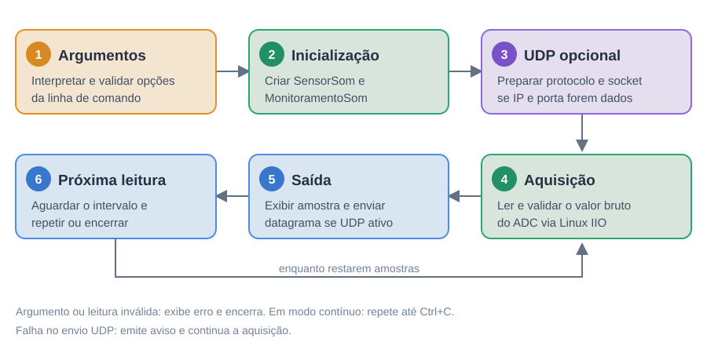
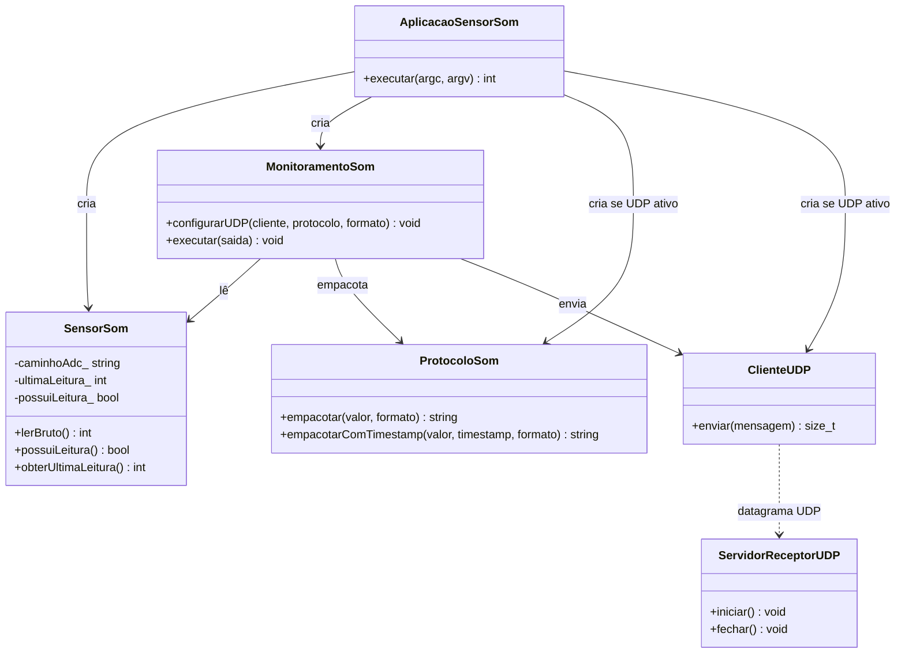
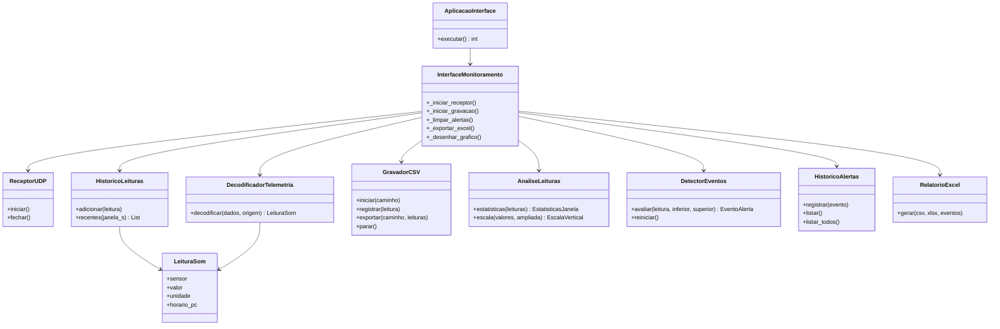

# Guia técnico — monitoramento acústico KY-037

Detalhes de arquitetura, instalação, protocolo, interface e análise. Para uma visão rápida, consulte o [README principal](../README.md).

<a id="objetivo"></a>

## Visão geral

O sistema lê a saída analógica do KY-037 na STM32MP1-DK1 e envia as amostras por UDP a um computador. A interface no PC apresenta o valor atual, o histórico gráfico e alertas por limites configuráveis; também grava CSV e gera relatório Excel.

A aplicação embarcada é escrita em C++ e usa o subsistema IIO do Linux. O receptor e a interface são escritos em Python 3. Os valores são **contagens brutas do ADC (raw)**, não decibéis; o sistema não grava áudio. A leitura, a comunicação e a interface foram demonstradas com dados reais do sensor. O [GIF no README principal](../README.md) e o [vídeo de demonstração](https://drive.google.com/file/d/1BVW8qoyFHY4mEYED9KS1cEBujymM_ru7/view?usp=sharing) mostram a execução.

<a id="sensor"></a>

## Sensor e funcionamento

Entenda como o KY-037 funciona e como sua saída analógica se liga à STM32.

Antes de alterar a fiação, desligue o kit. A [foto da montagem usada no ensaio](../evidencias/entrega0/conexao_ky037_stm32_energizado.png) mostra a placa energizada.

O módulo KY-037 capta som por um microfone e disponibiliza um sinal elétrico na saída analógica **AO**. Neste projeto, `+` é ligado a **3,3 V**, `G` a **GND** e `AO` à entrada **A4** da STM32MP1-DK1. A saída digital `DO` não é usada. O Linux disponibiliza a contagem do ADC pelo subsistema IIO; `SensorSom` abre o arquivo correspondente a cada amostra. O programa não converte essa contagem para tensão ou dB e não captura áudio. O intervalo pedido entre amostras pode variar por causa do escalonamento do Linux e da leitura do arquivo.

<a id="estrutura"></a>

## Estrutura do projeto

Consulte a árvore de arquivos e o papel das classes e métodos do sistema.

<details>
<summary>Ver estrutura do código e classes</summary>

```text
.
├── README.md                    Visão geral, uso e resultados
├── Makefile                     Compilação, testes e documentação
├── Doxyfile                     Configuração do Doxygen
├── main.cpp                     Interface de linha de comando C++
├── servidor_udp.py              Receptor UDP em terminal
├── interface_grafica.py         Interface Tkinter no PC
├── telemetria_gui.py            Classes de protocolo, histórico, alertas e CSV da GUI
├── relatorio_excel.py           Exportador OOXML / Excel com gráfico e alertas
├── include/                     Declarações das classes C++
│   ├── SensorSom.hpp
│   ├── MonitoramentoSom.hpp
│   ├── ProtocoloSom.hpp
│   └── ClienteUDP.hpp
├── src/                         Implementações correspondentes
│   ├── SensorSom.cpp
│   ├── MonitoramentoSom.cpp
│   ├── ProtocoloSom.cpp
│   └── ClienteUDP.cpp
├── testes/                      Testes locais de leitura, monitoramento e UDP
│   ├── teste_sensor_som.cpp
│   ├── teste_monitoramento_som.cpp
│   ├── teste_protocolo_udp.cpp
│   ├── teste_interface_udp.py    Testes do protocolo/histórico/rede/CSV (Python)
│   ├── teste_melhorias_interface.py  Estatísticas, escala e alertas
│   ├── teste_historico_longo.py     Histórico de 30 min e preservação de picos
│   ├── teste_relatorio_excel.py     Integridade do XLSX e gráfico
│   ├── teste_limpeza_alertas.py     Painel por gravação sem excluir CSV
│   ├── teste_layout_janela.py      Layout em janela reduzida (exige display)
│   ├── teste_gui_smoke.py          Abertura e alerta da GUI (exige display)
│   └── emissor_teste_udp.py     Emissor de dados SIMULADOS para teste local
├── dados/
│   └── leitura_exemplo.txt      Valor simulado para os testes
├── docs/
│   ├── guia-tecnico.md          Este guia detalhado
│   ├── historico-entregas.md    Registro das etapas acadêmicas
│   └── html/                    Saída local do Doxygen (não versionada)
└── evidencias/
    ├── entrega0/
    │   └── conexao_ky037_stm32_energizado.png  Foto da montagem durante o ensaio
    ├── entrega1/                Documentação Doxygen e capturas da classe
    │   ├── DOCUMENTACAO.md
    │   ├── INSTRUCOES.md
    │   ├── doxygen_sensor_som.png
    │   └── doxygen_metodos.png
    ├── entrega2/                Roteiro, medições e análise
    │   ├── ROTEIRO_ENTREGA2.md
    │   ├── ANALISE_ENTREGA2.md
    │   ├── silencio.csv
    │   ├── ruido.csv
    │   ├── ky037_comparacao_completa.png
    │   └── ky037_comparacao_ampliada.png
    ├── entrega3/                Capturas da comunicação UDP
    │   ├── terminal_stm32_udp.png
    │   └── servidor_udp_pc.jpg
    ├── entrega4/                Evidências reais da GUI e relatórios
    │   ├── INSTRUCOES.md
    │   ├── entrega4_terminal_stm32.png
    │   ├── entrega4_interface_monitoramento.png
    │   ├── entrega4_interface_alertas.png
    │   ├── entrega4_excel_grafico.png
    │   ├── entrega4_excel_alertas.png
    │   ├── ky037_log1231.csv
    │   └── Relatorio_KY037_1231.xlsx
    └── entrega5/
        └── interface.gif        Demonstração animada da interface
```

O arquivo em `include/` declara cada classe e o arquivo de mesmo nome em `src/` implementa seus métodos. [`DOCUMENTACAO.md`](../evidencias/entrega1/DOCUMENTACAO.md) é a página inicial usada pelo Doxygen. O HTML gerado em `docs/html/` e os executáveis compilados não fazem parte dos arquivos versionados.

### Classes e métodos

- `SensorSom`: recebe o caminho do arquivo ADC no construtor. `lerBruto()` abre o arquivo, valida um inteiro não negativo e guarda a última leitura válida. `possuiLeitura()`, `obterUltimaLeitura()` e `obterCaminhoAdc()` consultam o estado sem expor os atributos privados.
- `AplicacaoSensorSom` (em `main.cpp`): configura caminho ADC, intervalo, quantidade de amostras e envio UDP opcional; executa o monitoramento e informa erros.
- `MonitoramentoSom`: `configurarUDP()` associa cliente e protocolo; `executar()` lê periodicamente, exibe as amostras e envia os pacotes quando UDP está ativo.
- `ProtocoloSom`: `empacotar()` acrescenta o horário atual e `empacotarComTimestamp()` permite informar o horário explicitamente; ambos produzem JSON ou CSV.
- `ClienteUDP`: `enviar()` transmite um datagrama; o destrutor fecha o socket.
- `ServidorReceptorUDP` (Python): `iniciar()` escuta a porta, processa e apresenta as mensagens; `fechar()` libera o socket.
- `TesteSensorSom` (em `testes/teste_sensor_som.cpp`): verifica leitura simulada, estado inicial e preservação da última leitura quando a entrada é inválida.
- `InterfaceMonitoramento` e `AplicacaoInterface` (Python): interface Tkinter, atualização por `after()`, controles e alertas.
- `ReceptorUDP`: thread receptora que enfileira datagramas sem acessar widgets Tk.
- `DecodificadorTelemetria` e `LeituraSom`: validação e representação das mensagens JSON/CSV.
- `HistoricoLeituras`: mantém até 30 minutos de leituras, respeitando um limite de memória, com relógio monotônico do PC.
- `GravadorCSV`: gravação contínua em CSV e exportação da janela atual.
- `AnaliseLeituras`: estatísticas de média, mínimo e máximo, escala vertical e redução visual preservando extremos.
- `DetectorEventos`, `HistoricoAlertas` e `EventoAlerta`: detecção por transição de estado, histórico em CSV e separação entre painel da sessão e registros persistidos.
- `RelatorioExcel`: conversão de gravações CSV para planilha `.xlsx` com gráfico editável, todas as leituras e alertas registrados.

O código C++ organiza a lógica da aplicação e dos testes em classes, sem variáveis globais.

</details>

<a id="dependencias"></a>

## Dependências

Confira o que é necessário no computador e na placa para compilar e executar o projeto.

- Ubuntu ou outro Linux com `make`, `g++` e suporte a C++17 para compilar e executar os testes locais; a comunicação usa sockets POSIX.
- `doxygen` e `graphviz` (`dot`) para gerar a documentação HTML e os diagramas.
- Para compilação e execução na placa: SDK `arm-buildroot-linux-gnueabihf-g++` compatível com o Linux embarcado e acesso serial ou SSH.
- Python 3 (somente biblioteca padrão) e rede IPv4 entre computador e placa para executar o receptor UDP.
- **Tkinter** no computador com interface gráfica. No Windows, costuma acompanhar a instalação oficial do Python; no Ubuntu, se necessário: `sudo apt install python3-tk`. Não é preciso instalar Matplotlib/PyQt.
- A placa **não executa Tkinter**: ela executa o programa C++ e envia os dados por UDP.

<a id="compilacao-local"></a>

## Compilação e testes no Ubuntu (sem hardware)

Use estes comandos para compilar, testar e simular uma leitura sem a placa.

```bash
make
make test
make docs
```

O `make test` executa os testes de leitura, monitoramento e UDP em loopback, além de uma aquisição simulada com `dados/leitura_exemplo.txt` (valor fictício `88`). **Esses testes não substituem as medições reais do sensor.**

Para executar apenas uma aquisição simulada:

```bash
./sensor_som dados/leitura_exemplo.txt --amostras 3 --intervalo-ms 1
```

```text
Fonte ADC: dados/leitura_exemplo.txt
amostra,tempo_ms,adc_bruto
1,0,88
2,1,88
3,2,88
```

Os tempos podem variar conforme o sistema. Sem `--arquivo` ou caminho posicional, o programa usa o ADC configurado na STM32.

<a id="compilacao-stm32"></a>

## Compilação cruzada para STM32

Veja como gerar o executável ARM e transferi-lo para a STM32.

No Ubuntu, utilizando o SDK Buildroot fornecido:

```bash
make arm ARM_CXX="$HOME/Downloads/arm-buildroot-linux-gnueabihf_sdk-buildroot/bin/arm-buildroot-linux-gnueabihf-g++"
```

Esse comando produz `sensor_som_arm`. Use a toolchain compatível com o Linux da placa e confirme a arquitetura do executável antes da transferência.

Confirme que `file sensor_som_arm` identifica um executável ARM. Com SSH disponível, transfira o programa do computador para o kit (substitua o IP conforme sua rede):

```bash
scp -O sensor_som_arm root@192.168.42.2:/root/sensor_som_arm
```

<a id="canal-adc"></a>

## Canal ADC utilizado

Confira o canal IIO configurado e as opções para alterar o arquivo ADC.

- Entrada fisica escolhida: **A4**.
- Dispositivo IIO: `iio:device0` (nome `48003000.adc:adc@0`).
- Canal: `in_voltage13_raw`.
- Caminho completo: `/sys/bus/iio/devices/iio:device0/in_voltage13_raw`.
- Leituras ja observadas com **A4 conectado ao GND**: `56, 88, 0, 72, 0, 0` (contagens brutas), e escala `0.038146972` com offset `0`.
- As observacoes acima **nao sao leituras do KY-037**.

A aplicacao usa esse caminho por padrao, ou outro indicado como argumento na linha de comando.
Se a enumeração IIO mudar no kit, informe o novo arquivo com `--arquivo CAMINHO` ou como argumento posicional. Sem opções, o programa coleta **20 amostras** com intervalo solicitado de **200 ms**. `--continuo` coleta até `Ctrl+C` e não pode ser combinado com `--amostras`.

<a id="modelo-e-diagramas"></a>

## Arquitetura e diagramas

Consulte o modelo de `SensorSom`, o fluxograma e o diagrama das classes implementadas.

<details>
<summary>Ver modelo, fluxograma e diagrama de classes</summary>

```text
SensorSom
--------------------------------
- caminhoAdc_: std::string
- ultimaLeitura_: int
- possuiLeitura_: bool
--------------------------------
+ SensorSom(caminhoAdc)
+ lerBruto(): int
+ possuiLeitura(): bool
+ obterUltimaLeitura(): int
+ obterCaminhoAdc(): const string&
```

### Fluxograma da aplicação

<p align="center"></p>

Em `--continuo`, a coleta segue até o processo ser interrompido. Se o envio UDP falhar, a aplicação mostra `[Aviso UDP]` e continua a aquisição.

### Diagrama das classes implementadas



`ServidorReceptorUDP` é uma classe Python no computador; as outras classes deste diagrama são C++. A relação pontilhada representa a comunicação pela rede.

</details>

<a id="documentacao"></a>

## Documentação do código

As classes C++ usam comentários Doxygen, e os módulos Python trazem docstrings. O diagrama acima mostra a relação entre leitura, monitoramento, empacotamento e envio.

Instale `doxygen` e `graphviz` (`dot`) no computador e execute `make docs` na raiz do repositório. Abra `docs/html/index.html` no navegador para consultar classes, métodos, atributos e código-fonte. O HTML é gerado localmente e não é versionado; `Doxyfile` e os comentários do código permitem recriá-lo.

<a id="comunicacao-udp"></a>

## Comunicação UDP

Cada leitura válida é transmitida em um datagrama de texto UTF-8. O formato padrão é JSON; CSV pode ser selecionado na linha de comando. A porta e o IP do computador devem coincidir com a configuração do transmissor.

<details>
<summary>Ver protocolo, exemplos e comandos</summary>

| Campo | Tipo | Significado |
|---|---|---|
| `sensor` | texto | Identificador configurado com `--id-sensor`; padrão `KY-037` |
| `valor` | inteiro | Contagem bruta do ADC |
| `unidade` | texto | `raw` |
| `timestamp` | inteiro | Tempo Unix em milissegundos segundo o relógio da placa |

Mensagem JSON (padrão):

```json
{"sensor":"KY-037","valor":3857,"unidade":"raw","timestamp":946686107619}
```

Mensagem CSV (opção `--formato csv`), sem cabeçalho e na ordem `sensor,valor,unidade,timestamp`:

```text
KY-037,3857,raw,946686107619
```

No PC, para receber os pacotes em um terminal:

```bash
python3 servidor_udp.py 8080
```

Na STM32, após transferir o executável, substitua o IP pelo endereço atual do PC:

```bash
/root/sensor_som_arm --ip 192.168.42.1 --porta 8080 --continuo --intervalo-ms 100 --id-sensor KY-037 --formato json
```

`--ip` e `--porta` são usados juntos. O receptor em terminal e a interface gráfica não podem ocupar a mesma porta ao mesmo tempo. UDP não confirma recebimento nem garante entrega ou ordem. O relógio da placa pode estar desajustado; o `timestamp` do pacote não deve ser tratado como hora confiável sem sincronização. O `tempo_ms` mostrado no terminal da placa é o tempo decorrido desde o início do processo.

</details>

<a id="interface"></a>

## Interface de monitoramento

A interface Tkinter recebe os datagramas no computador, apresenta a leitura e o histórico, sinaliza valores fora dos limites definidos e permite salvar as amostras e exportar relatórios.

<details>
<summary>Ver funcionalidades, execução e arquivos gerados</summary>

| Função | Comportamento |
|---|---|
| Leitura e conexão | Valor atual, estado, IP de origem, última atualização e contagem de pacotes válidos e inválidos |
| Gráfico | Janelas de 30 s, 60 s, 5 min, 10 min ou 30 min; escalas automática e ampliada |
| Alertas | Limites inferior e superior configuráveis; eventos `ACIMA`, `ABAIXO` e `NORMALIZADO` |
| Histórico | Média, mínimo e máximo na janela; eventos persistidos em `alertas_ky037.csv` |
| Arquivos | Gravação contínua ou exportação de CSV; relatório `.xlsx` com gráfico editável |

No Linux com ambiente gráfico, na raiz do repositório:

```bash
python3 interface_grafica.py --porta 8080
```

No Windows, com `interface_grafica.py`, `telemetria_gui.py` e `relatorio_excel.py` na mesma pasta:

```powershell
py -3 interface_grafica.py --porta 8080
```

Depois de iniciar a interface, ajuste os limites e clique em **Aplicar limites**. Para registrar uma sessão, clique em **Gravar CSV** e escolha um nome novo; inicie o envio na STM32 com o comando da seção [Comunicação UDP](#comunicacao-udp). Ao terminar, interrompa o envio e clique em **Parar gravação**. **Exportar CSV** salva a janela disponível; **Relatório Excel** transforma uma gravação CSV em planilha, sem precisar de nova transmissão.

O CSV de amostras usa as colunas:

```csv
horario_pc,sensor,valor_adc,unidade,timestamp_placa_ms,ip_origem
```

O relatório Excel tem abas de visão geral, leituras, alertas e série do gráfico. As leituras originais permanecem completas mesmo quando a série desenhada é reduzida para melhorar a visualização. O arquivo `alertas_ky037.csv` acumula eventos; limpar o painel visual não apaga os registros persistidos. Uma gravação com nome já existente pode acrescentar linhas ao CSV.

O horário do PC é usado para o eixo temporal porque o relógio da STM32 pode estar desajustado. O limite de alerta é experimental: ultrapassá-lo indica uma leitura anômala, sem calibrar o sensor em dB. O receptor UDP e a GUI devem usar portas diferentes quando executados simultaneamente. Para testar a GUI com janela gráfica, execute `make test-gui-smoke` em uma sessão com display e Tkinter.

### Diagrama das classes da interface



</details>

<a id="resultados"></a>

## Medições e resultados

As leituras reais mostram contagens ADC mais altas e picos mais intensos na condição com ruído. Os números descrevem o ensaio realizado; não representam nível sonoro em decibéis nem um limiar universal para detectar violação.

Em duas séries de 100 amostras, com intervalo solicitado de 100 ms:

| Indicador (ADC raw) | Silêncio | Ruído |
|---|---:|---:|
| Média | 4.137,13 | 5.111,61 |
| Mediana | 4.173 | 4.408,5 |
| Mínimo | 3.522 | 3.190 |
| Máximo | 4.561 | 41.204 |

[Dados em silêncio](../evidencias/entrega2/silencio.csv) · [Dados com ruído](../evidencias/entrega2/ruido.csv) · [Gráfico comparativo](../evidencias/entrega2/ky037_comparacao_completa.png) · [Análise detalhada](../evidencias/entrega2/ANALISE_ENTREGA2.md).

Outra [gravação real de 357 leituras](../evidencias/entrega4/ky037_log1231.csv), recebidas via UDP em 35,598 s, teve média de **3.939,48**, mínimo de **3.313** e máximo de **14.381 ADC raw**. Dezesseis leituras ficaram acima do limite experimental de **4.400**. O [relatório Excel](../evidencias/entrega4/Relatorio_KY037_1231.xlsx) inclui gráfico, todas as amostras e eventos persistidos. As capturas da interface e esse CSV podem pertencer a sessões distintas; os contadores de uma captura não devem ser interpretados como quantidade de linhas do arquivo.

A aquisição perto de 10 Hz não reconstrói a forma de onda do áudio e pode deixar de registrar transientes curtos. O horário do PC é a referência temporal para essas medições.
