# Histórico das entregas e evidências

Registro das etapas acadêmicas e das evidências originais. O [README principal](../README.md) apresenta o sistema como projeto de engenharia.

<a id="historico-entregas"></a>

## Histórico das entregas

As seções seguintes organizam as evidências por etapa. A descrição do sistema, o protocolo, as instruções de uso e os resultados estão no [README principal](../README.md) e no [guia técnico](guia-tecnico.md). Clique em uma imagem para abri-la no tamanho original.

<a id="entrega-0"></a>

## Entrega 0 — Conexão física do sensor

Consulte a foto da montagem usada no ensaio e a observação sobre a foto exigida com o kit desligado.

<a id="entrega-0-foto"></a>

### Foto da montagem

<a href="../evidencias/entrega0/conexao_ky037_stm32_energizado.png">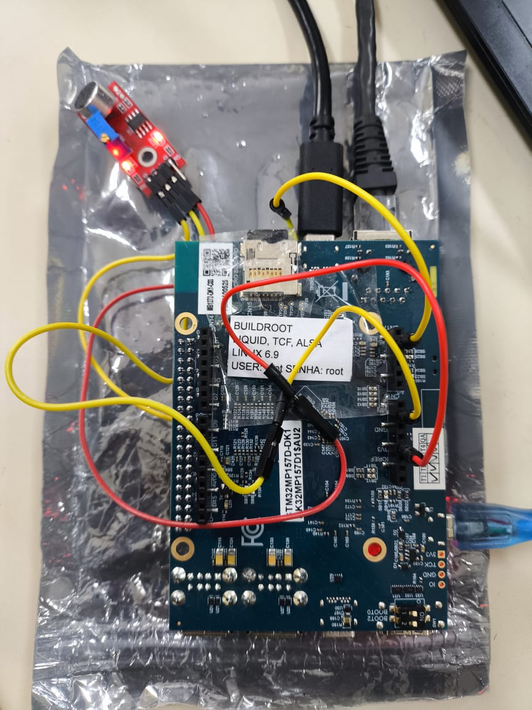</a>

A foto mostra o conjunto **energizado**. Ela documenta a montagem usada no ensaio, mas não substitui a foto com o kit **desligado** exigida antes dos testes pelo enunciado. Nessa montagem, `+` vai a 3,3 V, `G` a GND e `AO` a A4; a saída `DO` fica livre.


<a id="entrega-1"></a>

## Entrega 1 — Classe C++ e documentação Doxygen

Consulte a documentação da classe de leitura do sensor, os comandos Doxygen e as capturas geradas.

<a id="entrega-1-geracao"></a>

### Geração da documentação

Instale Doxygen e Graphviz no Ubuntu (caso ainda nao estejam instalados):

```bash
sudo apt-get update
sudo apt-get install doxygen graphviz
```

Na raiz do projeto, execute:

```bash
doxygen --version
dot -V
doxygen Doxyfile
```

Abra `docs/html/index.html` no navegador. Confira as paginas das classes
`SensorSom` e `AplicacaoSensorSom`, os metodos, os atributos privados e os
arquivos-fonte. O arquivo `Doxyfile` ativa opcoes sugeridas nos slides da
disciplina: `EXTRACT_PRIVATE`, `EXTRACT_STATIC`, `SOURCE_BROWSER`,
`INLINE_SOURCES`, `HAVE_DOT`, `UML_LOOK` e `DOT_UML_DETAILS`.

<a id="entrega-1-evidencias"></a>

### Evidências da Entrega 1

As imagens abaixo foram obtidas da documentação Doxygen
gerada no Ubuntu.

**Diagrama UML da classe SensorSom:**

<a href="../evidencias/entrega1/doxygen_sensor_som.png">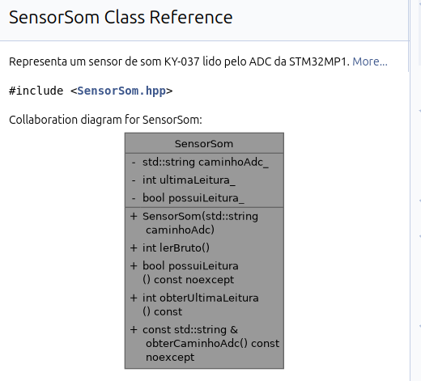</a>

**Documentação dos métodos:**

<a href="../evidencias/entrega1/doxygen_metodos.png">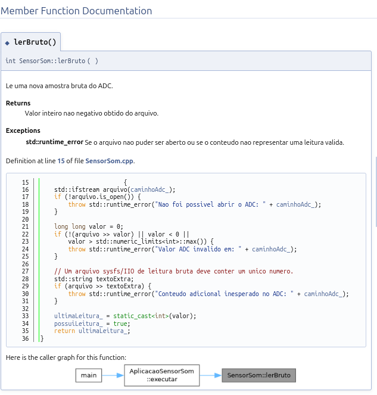</a>

A documentação HTML completa pode ser gerada com
`doxygen Doxyfile`. A pasta `docs/html/` não é
versionada no Git: os comentários Doxygen estão nos arquivos-fonte, e o `Doxyfile` permite recriar o HTML. Os comandos de teste estão no [README principal](../README.md#testes-e-automação).


<a id="entrega-2"></a>

## Entrega 2 — Resultados experimentais

Compare as medições em silêncio e com ruído, com gráficos e instruções de reprodução.

<a id="entrega-2-medicoes"></a>

### Comparação das medições

O programa foi executado na STM32MP1-DK1 com o sensor
KY-037 conectado à entrada analógica A4.

Foram realizadas 100 leituras em silêncio e 100 com ruído,
utilizando intervalo solicitado de 100 ms.

| Indicador | Silêncio | Ruído |
|---|---:|---:|
| Média | 4.137,13 | 5.111,61 |
| Mediana | 4.173 | 4.408,5 |
| Mínimo | 3.522 | 3.190 |
| Máximo | 4.561 | 41.204 |

O teste com ruído apresentou picos mais elevados.
Esses valores representam contagens brutas do ADC,
não níveis sonoros em decibéis.

<a id="entrega-2-evidencias"></a>

### Evidências

<a href="../evidencias/entrega2/ky037_comparacao_completa.png">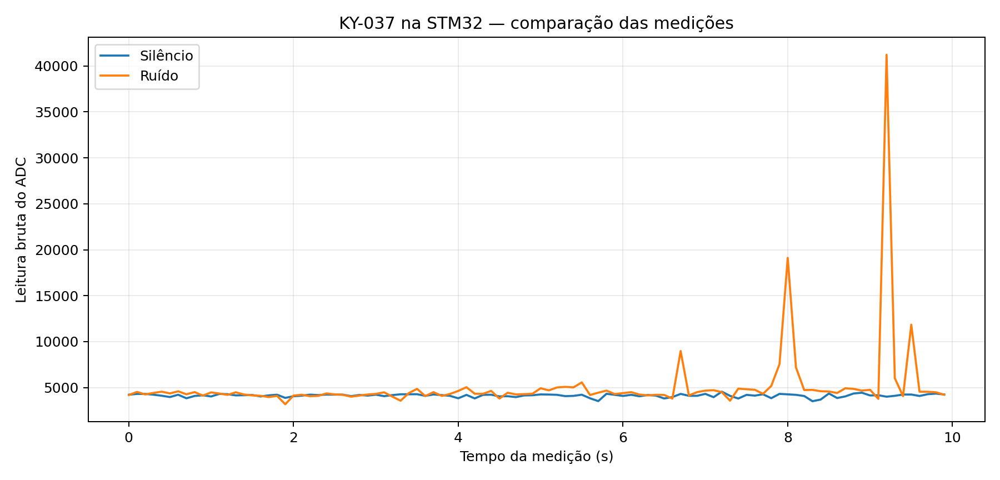</a>

<a href="../evidencias/entrega2/ky037_comparacao_ampliada.png">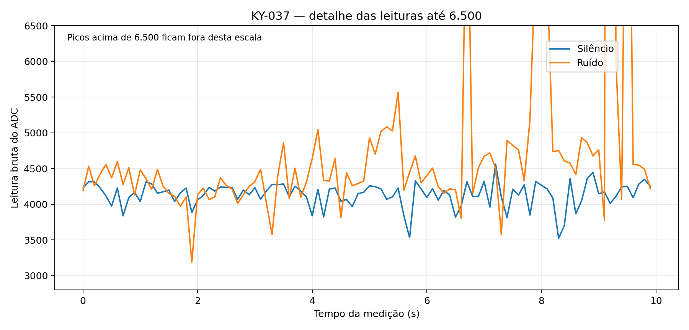</a>

[Análise detalhada](../evidencias/entrega2/ANALISE_ENTREGA2.md) · [Roteiro para reproduzir a aquisição](../evidencias/entrega2/ROTEIRO_ENTREGA2.md)

<a id="entrega-2-execucao"></a>

### Execução na STM32

Para executar o programa após transferi-lo para a placa:

    cd /root
    chmod +x sensor_som_arm
    ./sensor_som_arm --amostras 100 --intervalo-ms 100


<a id="entrega-3"></a>

## Entrega 3 — Comunicação e protocolo UDP

Veja o formato dos pacotes, os comandos de transmissão e as capturas da comunicação real.

Nesta etapa, implementou-se o envio de cada amostra do sensor KY-037 a partir do kit STM32MP1-DK1 para um receptor no computador via socket UDP.

<a id="entrega-3-arquitetura"></a>

### Arquitetura orientada a objetos (C++)

- `include/ClienteUDP.hpp` e `src/ClienteUDP.cpp`: classe encapsulada com RAII para gerenciamento do socket UDP POSIX (`socket`, `sendto`, `close`), tratamento de exceções e sem variáveis globais no código C++.
- `include/ProtocoloSom.hpp` e `src/ProtocoloSom.cpp`: classe responsável pela formatação e montagem dos pacotes nos formatos JSON (padrão) e CSV.
- `include/MonitoramentoSom.hpp` e `src/MonitoramentoSom.cpp`: integração do laço temporal de aquisição com o envio UDP concorrente à exibição local.
- `main.cpp`: expansão da CLI com os parâmetros `--ip`, `--porta`, `--id-sensor`  e `--formato`.
- `servidor_udp.py`: receptor em Python para validação e recepção no computador do operador.
- `testes/teste_protocolo_udp.cpp`: testes unitários de serialização e envio/recepção em loopback (`127.0.0.1`).

<a id="entrega-3-protocolo"></a>

### Especificação do Protocolo de Mensagens

Cada amostra enviada produz um datagrama UDP de texto UTF-8 com os campos `sensor`, `valor`, `unidade` e `timestamp`. UDP não confirma recebimento nem garante entrega ou ordem:

| Campo | Tipo | Descrição | Exemplo |
| :--- | :--- | :--- | :--- |
| `sensor` | `string` | Identificador único do sensor/grupo | `"KY-037"` |
| `valor` | `inteiro` | Leitura bruta do ADC (`in_voltage13_raw`) | `3857` |
| `unidade` | `string` | Unidade da grandeza lida | `"raw"` |
| `timestamp` | `inteiro (ms)`| Tempo Unix em milissegundos segundo o relógio da placa | `946686107619` |


<a id="entrega-3-json"></a>

#### Formato JSON (padrão):
```json
{"sensor":"KY-037","valor":3857,"unidade":"raw","timestamp":946686107619}
```


<a id="entrega-3-csv"></a>

#### Formato CSV (alternativo, ordem `sensor,valor,unidade,timestamp`, sem cabeçalho):
```text
KY-037,3857,raw,946686107619
```


<a id="entrega-3-execucao"></a>

### Instruções de execução

Confira o endereço IPv4 do computador conectado à STM32 (no Windows, `ipconfig`). Esse endereço deve ser informado em `--ip`, e a porta UDP deve ser a mesma nos dois lados.

1. **No computador (servidor receptor):**
   ```bash
   python3 servidor_udp.py 8080
   ```

2. **Na STM32MP1-DK1 (transmissor):**
   ```bash
   cd /root
   chmod +x sensor_som_arm
   ./sensor_som_arm --ip 192.168.42.10 --porta 8080 --amostras 30 --intervalo-ms 100
   ```

No teste documentado, o computador utilizou `192.168.42.10`; substitua-o pelo IP atual do receptor, caso seja diferente.
Use `--formato csv` para enviar CSV; o receptor o exibe como texto. Use `--id-sensor NOME` para mudar a identificação. `--ip` e `--porta` precisam ser informados juntos. O receptor mostra as mensagens no terminal e não implementa gráficos ou alertas.

**Observação:** na captura do teste, o relógio da STM32 não estava sincronizado; o `timestamp` demonstra o formato do pacote, mas não corresponde à data real da aquisição.
O `tempo_ms` da saída local é o tempo decorrido desde o início do programa e não equivale ao `timestamp` Unix da mensagem.

<a id="entrega-3-evidencias"></a>

### Evidências da Execução Real no Kit STM32

Os testes foram realizados conectando a STM32MP1-DK1 (`192.168.42.2`) ao computador (`192.168.42.10`) via cabo Ethernet:

**1. Execução no terminal da STM32MP1-DK1 (TeraTerm via Serial):**

<a href="../evidencias/entrega3/terminal_stm32_udp.png">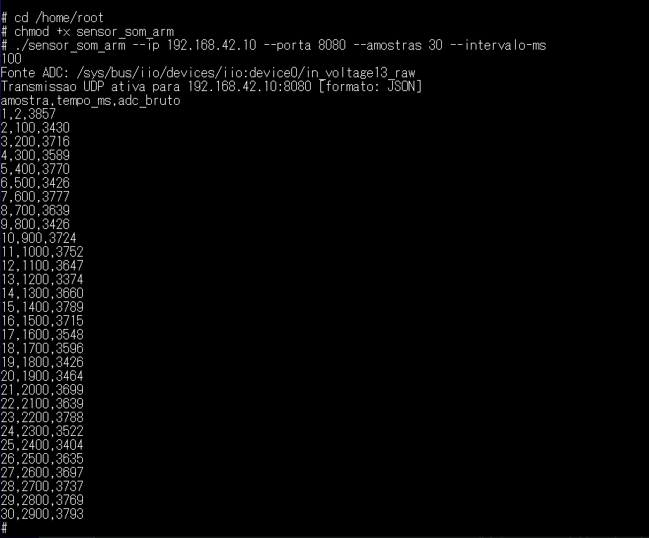</a>

**2. Recepção em tempo real no servidor central (PC:)**

<a href="../evidencias/entrega3/servidor_udp_pc.jpg">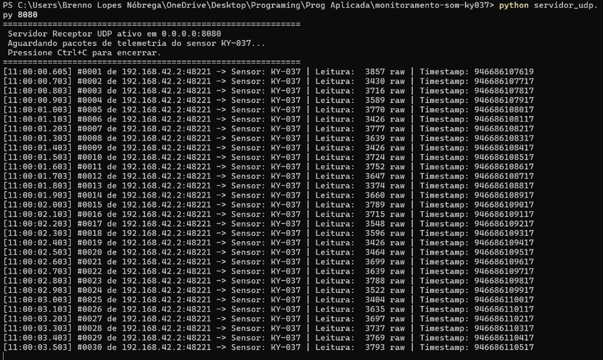</a>

Na execução documentada, o servidor recebeu 30 mensagens enviadas pela STM32. O UDP não garante a entrega de todos os pacotes em qualquer condição de rede.


<a id="entrega-4"></a>

## Entrega 4 — Interface gráfica de monitoramento no computador

Conheça a interface, o uso no PC, o CSV, as medições reais e os testes. O GIF está visível no início do [README principal](../README.md).

<a id="entrega-4-resultado"></a>

### Resultado obtido

A interface **Python 3 / Tkinter** recebeu por **UDP (porta 8080)** leituras **reais** do KY-037, ligado à STM32MP1-DK1. O terminal da placa, a janela da interface e o relatório Excel estão documentados com capturas reais abaixo. A STM32 executa o **programa C++ em Linux embarcado**; a interface e o relatório são executados no **PC**. O receptor `servidor_udp.py` da Entrega 3 e a interface gráfica não devem ocupar a mesma porta simultaneamente.

**Observação sobre as evidências:** as capturas do Tera Term, da interface gráfica e o CSV anexado podem ter sido obtidos em **sessões distintas**. Na captura da GUI, por exemplo, o contador total indica **5.288 pacotes válidos** desde a abertura, enquanto o CSV `ky037_log1231.csv` contém **357 leituras de uma gravação específica**. Não interpretar esses valores como contagens da mesma sessão.

<a id="entrega-4-funcionalidades"></a>

### Funcionalidades implementadas

| Função | Comportamento |
|---|---|
| Leitura em tempo real | Mostra contagem ADC atual, estado da conexão, IP de origem, último recebimento e quantidade de pacotes válidos/inválidos. |
| Gráfico temporal | Histórico selecionável: **30 s, 60 s, 5 min, 10 min ou 30 min**; escala **Automática** ou **Ampliada**. A curva persiste após o término do envio enquanto a interface permanecer aberta. |
| Escala ampliada | Valoriza a faixa usual das medições e sinaliza os picos fora da área visível; os valores originais permanecem no histórico e no CSV. |
| Estatísticas | Média, mínimo e máximo das leituras na janela selecionada. |
| Alerta visual | Indica leitura acima/abaixo de limites configuráveis por **Aplicar limites**. Os eventos são gerados nas mudanças de estado (`ACIMA`, `ABAIXO`, `NORMALIZADO`). |
| Histórico por gravação | Ao iniciar **Gravar CSV** com sucesso, a **lista visual** de alertas começa vazia. **Zerar painel (preserva CSV)** limpa só a tela. Nenhuma dessas ações apaga ou reescreve os alertas já salvos no arquivo histórico. |
| Registro permanente de alertas | O arquivo **`alertas_ky037.csv`** no diretório de trabalho acumula os eventos de várias sessões; novos eventos são acrescentados. O painel visual e o reconhecimento não alteram os registros anteriores. |
| Gravação de amostras | **Gravar CSV**, **Parar gravação** e **Exportar CSV**. A gravação salva as leituras válidas à medida que chegam; a exportação manual salva a janela disponível. |
| Relatório Excel | **Relatório Excel** converte um CSV gravado em `.xlsx`, com abas de visão geral, leituras, alertas e série do gráfico. O gráfico é editável no Excel e não rotula individualmente centenas de pontos. |

As unidades são **contagens brutas ADC (`raw`)**, **não decibéis (dB)**. Os limiares são **experimentais**, não uma calibração acústica nem prova automática de violação da carga. O recebimento ocorre por UDP, que não garante entrega. O relógio da STM32 pode estar desajustado; para as medições anexadas, o **horário do PC** é a referência temporal confiável. A aquisição a aproximadamente 10 Hz não representa a forma de onda completa do áudio e pode não capturar transientes curtos.

<a id="entrega-4-execucao"></a>

### Executar a interface no PC e na STM32

**No Windows (PowerShell, pasta com os três arquivos Python):**

```powershell
cd C:\Compartilhada_EE
py -3 interface_grafica.py --porta 8080
```

Se executar pelo próprio repositório em vez da pasta compartilhada, entre primeiro na pasta correspondente. Os arquivos `interface_grafica.py`, `telemetria_gui.py` e `relatorio_excel.py` precisam estar juntos. O Python padrão para Windows inclui `tkinter` na instalação usual. No Ubuntu gráfico, use `python3 interface_grafica.py --porta 8080`; se faltar `tkinter`, instale `python3-tk` compatível com o Python utilizado. Não são necessárias bibliotecas externas como Matplotlib, `openpyxl` ou `xlsxwriter` para executar a aplicação.

**Preparação física:** com o kit desligado para qualquer alteração de fios, KY-037 `+` em **3,3 V**, `G` em **GND** e `AO` em **A4**; `DO` não é utilizado. Conectar a Ethernet da placa ao PC e conferir a comunicação. Na configuração testada, a placa usou `192.168.42.2` e a Ethernet do PC `192.168.42.1`, sujeitos a alterações em outras redes.

**Na STM32 (Tera Term, prompt `#`):**

```bash
/root/sensor_som_arm --ip 192.168.42.1 --porta 8080 --continuo --intervalo-ms 100 --id-sensor KY-037 --formato json
```

Esse comando utiliza a versão C++ com UDP da Entrega 3. Para encerrar o envio, pressione **Ctrl+C no Tera Term**. Se for necessário transferir o binário ARM a partir do Windows, use `scp -O` e confira a assinatura SSH da placa antes de aceitar chaves alteradas. O comando de ajuda na placa é `/root/sensor_som_arm --ajuda` (não `--help`).

**Procedimento de gravação:** abra a interface, defina os limites e clique em **Aplicar limites**; selecione a janela temporal; clique em **Gravar CSV** e salve com um **nome novo**; inicie a STM32; depois interrompa a transmissão e clique em **Parar gravação**. A criação de uma nova gravação zera **apenas os alertas mostrados no painel**, preservando `alertas_ky037.csv`. Não reutilize o nome do CSV para sessões diferentes, pois a gravação pode acrescentar linhas ao arquivo existente.

<a id="entrega-4-arquivos"></a>

### Formato do arquivo CSV e do relatório Excel

O CSV de leituras possui as colunas:

```csv
horario_pc,sensor,valor_adc,unidade,timestamp_placa_ms,ip_origem
```

O botão **Relatório Excel** permite selecionar uma gravação `.csv` já realizada e gerar `.xlsx`, sem nova transmissão da STM32. O arquivo contém:

- **Visao Geral** — resumo estatístico, horários da sessão, referência de limites e gráfico XY editável de ADC bruto versus tempo transcorrido;
- **Leituras** — todas as amostras válidas do CSV de origem, sem eliminar os picos;
- **Alertas** — eventos realmente presentes no log persistente da GUI, distinguindo os da gravação escolhida dos de sessões anteriores;
- **Serie Grafico** — pontos utilizados para desenhar a curva. Em arquivos extensos, a quantidade de pontos **do gráfico** pode ser reduzida preservando os extremos; as linhas da aba **Leituras** permanecem intactas.

A linha do limite mostrada no Excel é uma **referência configurada na exportação**; para saber os limites efetivos associados a um alerta histórico, consulte as colunas do próprio evento. A aba **Alertas** não cria alarmes que não foram registrados pela GUI.

<a id="entrega-4-medicoes"></a>

### Medições experimentais documentadas

A gravação real [`ky037_log1231.csv`](../evidencias/entrega4/ky037_log1231.csv), de **14/11/2026**, contém:

| Indicador | Resultado |
|---|---:|
| Sensor e origem | `KY-037` / `192.168.42.2` |
| Intervalo medido pelo relógio do PC | `23:41:28.837` a `23:42:04.435` (UTC−03:00) |
| Duração | **35,598 s** |
| Amostras válidas | **357** |
| Média | **3.939,48 ADC raw** |
| Mínimo / máximo | **3.313 / 14.381 ADC raw** |
| Leituras acima de 4.400 | **16** |
| Limite superior da sessão documentada | **4.400 ADC raw** |

O relatório [`Relatorio_KY037_1231.xlsx`](../evidencias/entrega4/Relatorio_KY037_1231.xlsx) contém **152 eventos históricos** no total; **32** estão marcados como pertencentes a essa gravação (16 ultrapassagens e 16 normalizações). **Eventos** não são o mesmo que **amostras**: uma passagem para `ACIMA` seguida de retorno à faixa normal gera dois eventos. Os números deste CSV não devem ser confundidos com as contagens da captura de interface obtida em outra ocasião.

<a id="entrega-4-evidencias"></a>

### Evidências reais da Entrega 4

**1. Aquisição na STM32 — terminal serial (Tera Term)**

<a href="../evidencias/entrega4/entrega4_terminal_stm32.png">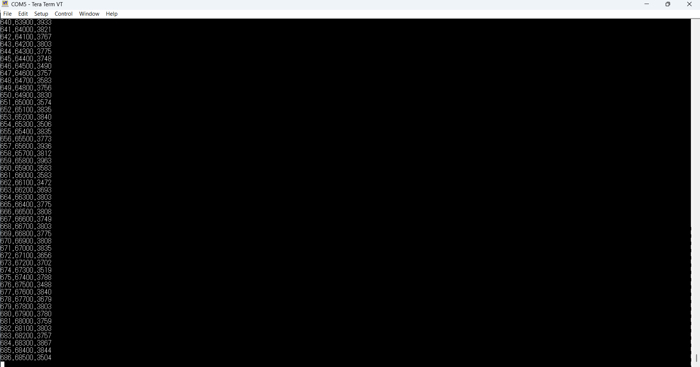</a>

A imagem mostra a sequência de amostras, tempo decorrido e contagens do ADC. **O comando completo com endereço IP e porta UDP não aparece nesta captura**; a comunicação é corroborada pela GUI recebendo pacotes da placa e pelas evidências da Entrega 3.

**2. GUI do PC recebendo UDP e desenhando o gráfico temporal**

<a href="../evidencias/entrega4/entrega4_interface_monitoramento.png">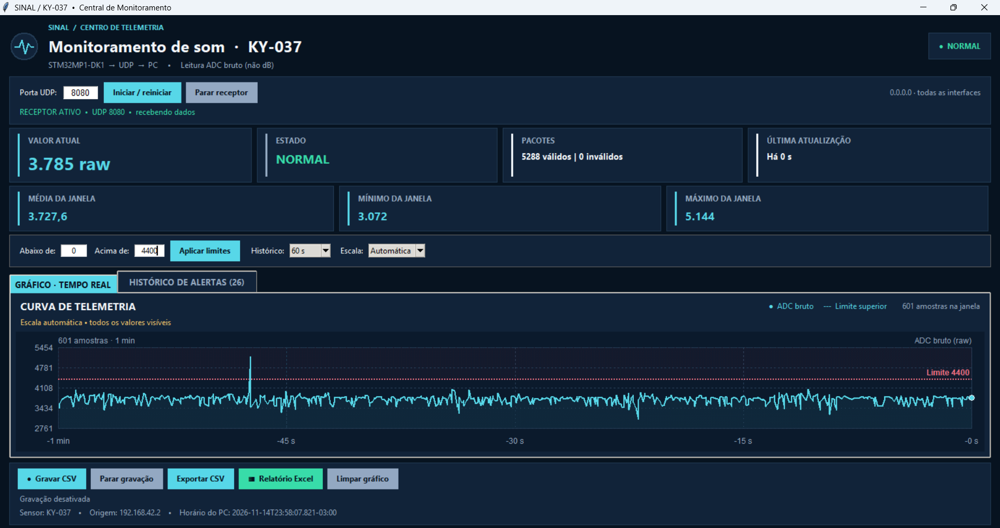</a>

A captura mostra o receptor ativo na porta **8080**, origem **192.168.42.2**, leituras em tempo real, **5.288 pacotes válidos**, gráfico de **60 s** com **601 amostras**, estatísticas e limite superior **4.400 ADC raw**. O contador representa o acumulado desde a inicialização do receptor e **não** o tamanho do CSV anexado.

**3. Histórico visual de ultrapassagens e normalizações**

<a href="../evidencias/entrega4/entrega4_interface_alertas.png">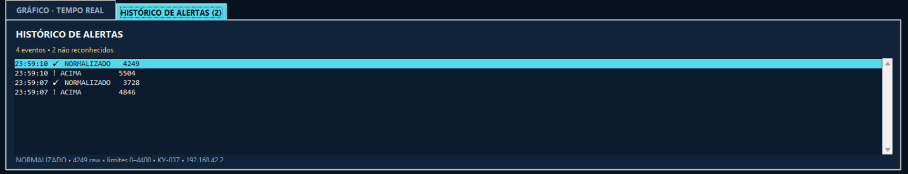</a>

A imagem apresenta eventos `ACIMA` e `NORMALIZADO`, incluindo valores **4.846**, **5.504**, **3.728** e **4.249 ADC raw**, com limite superior **4.400**. A lista visual pertence à sessão em curso e não substitui o arquivo histórico persistente.

**4. Gráfico da gravação exportado para Excel**

<a href="../evidencias/entrega4/entrega4_excel_grafico.png">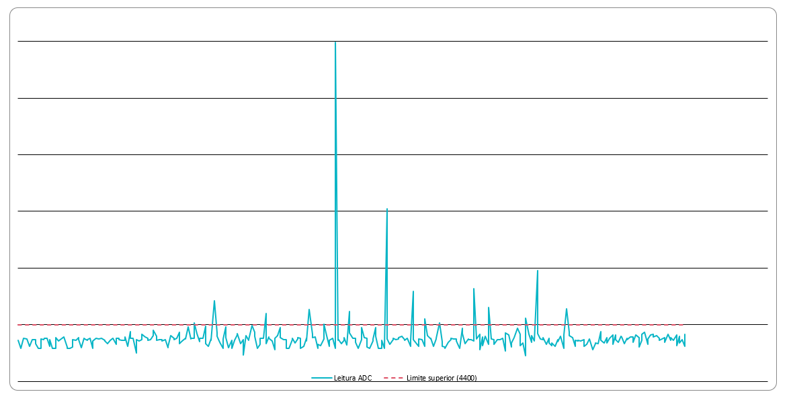</a>

**5. Alertas registrados no relatório Excel**

<a href="../evidencias/entrega4/entrega4_excel_alertas.png">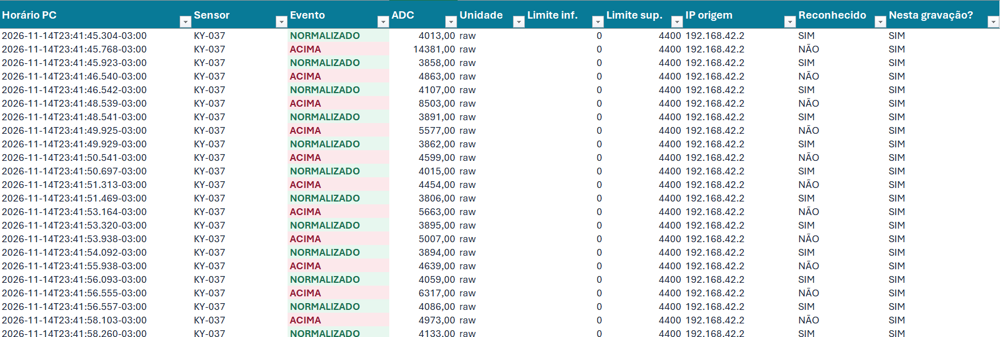</a>

**Arquivos de dados e instruções:** [CSV com 357 leituras](../evidencias/entrega4/ky037_log1231.csv) · [Relatório Excel com gráfico e histórico](../evidencias/entrega4/Relatorio_KY037_1231.xlsx) · [Procedimento e inventário das evidências](../evidencias/entrega4/INSTRUCOES.md).

**Limite de comprovação:** o histórico de 5, 10 e 30 minutos e as funcionalidades de exportação foram implementados e submetidos a testes automatizados, mas **não se afirma aqui que uma aquisição física de 30 minutos tenha sido realizada**. O conjunto de evidências apresenta testes reais mais curtos e outras capturas da interface em funcionamento.

<a id="entrega-4-testes"></a>

### Testes automatizados e organização do código

No **Ubuntu**, o comando `make test` verifica a leitura do ADC simulado, monitoramento, envio UDP, decodificação, histórico de amostras, alertas e relatório Excel. O conjunto de testes atual também inclui a verificação de que **zerar a aba de alertas não apaga o CSV persistente**. Ele requer `tkinter` importável pelo Python usado nos testes. Para testes gráficos que abrem janelas (e exigem display), use `make test-gui-smoke`.

```bash
make test
make test-gui-smoke  # somente em uma sessão gráfica com Tkinter
```

As classes de C++ da STM32 continuam documentadas com Doxygen. As classes Python usam docstrings, encapsulamento e atualização dos widgets na thread da GUI; a recepção UDP opera separadamente.


<a id="entrega-5"></a>

## Entrega 5 — Demonstração e apresentação

Acesse o vídeo, o GIF e as orientações para a apresentação final.

<a id="entrega-5-video-gif"></a>

### Vídeo e GIF

- [Vídeo de demonstração no Google Drive](https://drive.google.com/file/d/1BVW8qoyFHY4mEYED9KS1cEBujymM_ru7/view?usp=sharing).
- [Demonstração animada da interface](../evidencias/entrega5/interface.gif).
- O fluxograma, os diagramas de classes, as instruções de compilação e uso, o protocolo, a descrição do sensor, as capturas da interface e a análise das medições estão no [guia técnico](guia-tecnico.md) e no [README principal](../README.md).

<a id="indice-evidencias"></a>

## Índice da documentação e das evidências

Encontre rapidamente os arquivos e registros de cada entrega.

| Etapa | Documentação e evidências disponíveis |
|---|---|
| Entrega 0 | [Foto da montagem física durante o ensaio](../evidencias/entrega0/conexao_ky037_stm32_energizado.png); ainda é necessária a foto do kit desligado exigida pelo enunciado, caso não tenha sido enviada separadamente ao professor. |
| Entrega 1 | [Diagrama Doxygen de `SensorSom`](../evidencias/entrega1/doxygen_sensor_som.png), [captura dos métodos](../evidencias/entrega1/doxygen_metodos.png), [instruções e inventário](../evidencias/entrega1/INSTRUCOES.md) e [página inicial do Doxygen](../evidencias/entrega1/DOCUMENTACAO.md). |
| Entrega 2 | [Roteiro de reprodução](../evidencias/entrega2/ROTEIRO_ENTREGA2.md), [dados em silêncio](../evidencias/entrega2/silencio.csv), [dados com ruído](../evidencias/entrega2/ruido.csv), gráficos exibidos acima e [análise detalhada](../evidencias/entrega2/ANALISE_ENTREGA2.md). |
| Entrega 3 | [Captura do terminal da STM32](../evidencias/entrega3/terminal_stm32_udp.png) e [captura do terminal receptor no computador](../evidencias/entrega3/servidor_udp_pc.jpg), ambos com os programas em funcionamento. |
| Entrega 4 | [Interface Tkinter](../interface_grafica.py), [telemetria e alertas](../telemetria_gui.py), [exportador Excel](../relatorio_excel.py), [CSV real](../evidencias/entrega4/ky037_log1231.csv), [relatório XLSX](../evidencias/entrega4/Relatorio_KY037_1231.xlsx), [captura do Tera Term](../evidencias/entrega4/entrega4_terminal_stm32.png), [captura da GUI](../evidencias/entrega4/entrega4_interface_monitoramento.png) e [histórico de alertas](../evidencias/entrega4/entrega4_interface_alertas.png). |
| Entrega 5 | [Vídeo de demonstração](https://drive.google.com/file/d/1BVW8qoyFHY4mEYED9KS1cEBujymM_ru7/view?usp=sharing), [GIF da interface](../evidencias/entrega5/interface.gif) e documentação nesta página. |

Os arquivos `silencio.csv` e `ruido.csv` da Entrega 2 começam com a linha `Fonte ADC: ...` antes do cabeçalho CSV. A documentação completa das classes embarcadas pode ser gerada com `make docs`. As capturas reais da Entrega 4 já foram inseridas acima; é necessário **confirmar sua renderização no GitHub após o push** e conferir que os arquivos foram incluídos no commit.
