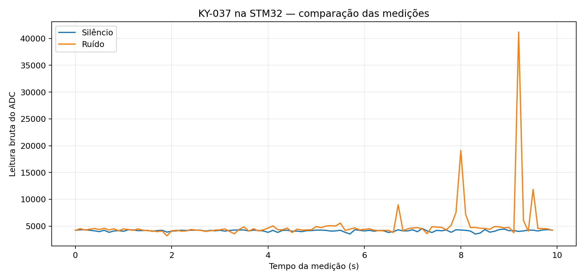
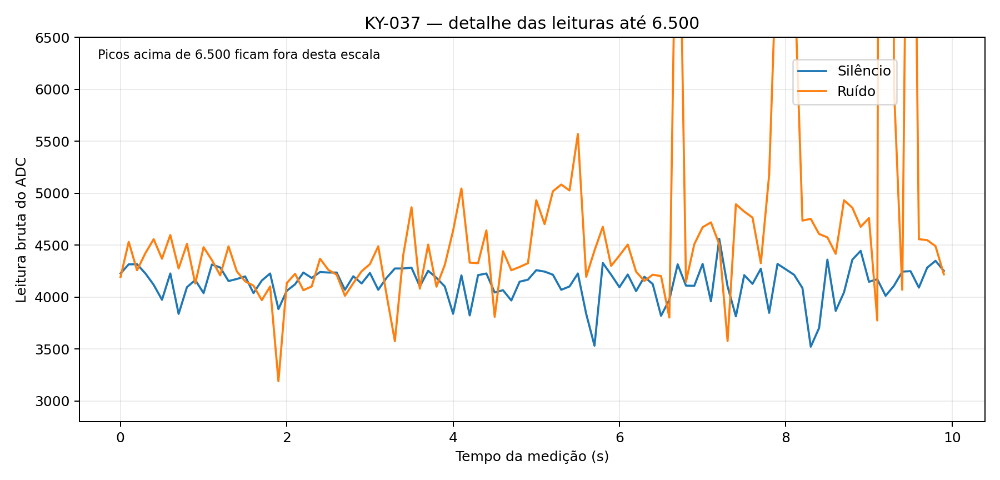

# Evidências da Entrega 2 — KY-037 / STM32MP1-DK1

Foram realizadas duas aquisições reais na STM32MP1-DK1, usando a entrada
ADC A4 (arquivo Linux `/sys/bus/iio/devices/iio:device0/in_voltage13_raw`),
com 100 amostras por condição e intervalo solicitado de 100 ms.

| Indicador (contagens brutas ADC) | Silêncio | Ruído |
|---|---:|---:|
| Amostras | 100 | 100 |
| Média | 4.137,13 | 5.111,61 |
| Mediana | 4.173 | 4.408,5 |
| Mínimo | 3.522 | 3.190 |
| Máximo | 4.561 | 41.204 |
| Desvio-padrão amostral | 173,00 | 4.057,05 |
| Leituras acima de 5.000 | 0 | 13 |

A média foi aproximadamente 23,6% maior na condição de ruído.
Foram observados picos de 19.114 e 41.204 no teste com ruído,
enquanto o máximo no silêncio foi 4.561.

Esses resultados são compatíveis com uma resposta do conjunto
microfone/ADC à mudança de condição sonora, mas não constituem
calibração acústica nem medida de nível de pressão sonora em dB.
Os picos influenciam fortemente a média; por isso apresentamos também
a mediana. A aquisição de uma amostra a cada ~100 ms pode deixar
de registrar transientes muito rápidos. Repetições controladas
podem fortalecer a validação.

## Gráficos

## Dados brutos

- `silencio.csv`
- `ruido.csv`

Nota: os arquivos originais possuem uma primeira linha `Fonte ADC: ...`
antes do cabeçalho CSV. Para importação em pandas, usar `skiprows=1`.
